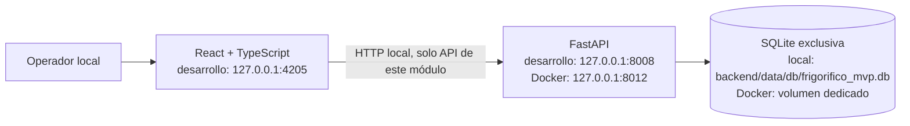
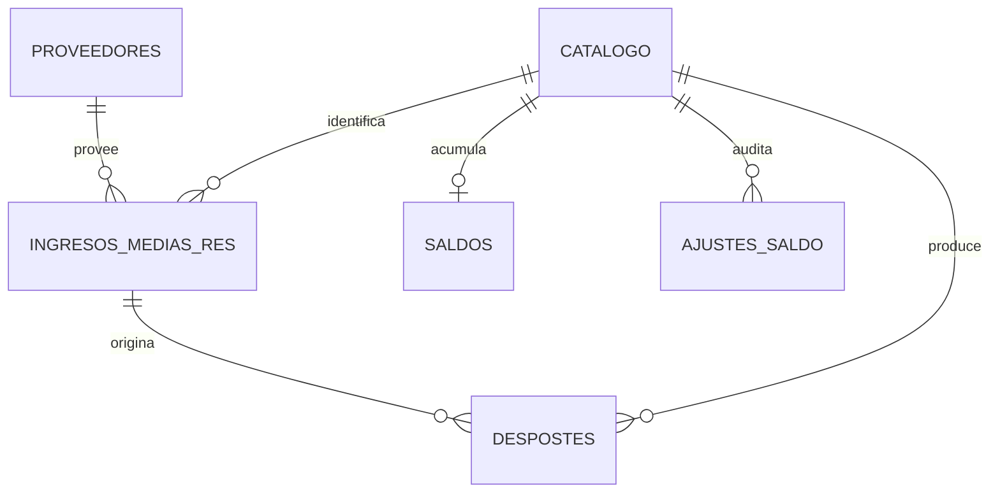

# Especificación orientada a arquitectura modular — ALANTIA Frigorífico 0.1.0

## Propósito y evidencia

Este documento define una **especificación orientada a arquitectura modular** y una primera implementación local verificable. El dominio y los flujos se contrastaron con el catálogo canónico de [PORTFOLIO_HUB.md](../../PORTFOLIO_HUB.md), la planificación y el índice de referencias de [`/md`](../../md/README.md). El índice resume antecedentes históricos de dominio; este módulo mantiene código, datos sintéticos, persistencia y API propios, sin reutilizar servicios ni datos históricos.

El sistema nuevo usa modelos y datos sintéticos propios. No afirma equivalencia funcional con el producto histórico ni disponibilidad productiva.

## Límites del subsistema

- El frontend no comparte runtime, configuración, storage o servicios con la landing ni con otros subsistemas.
- FastAPI es la única capa autorizada para leer/escribir datos; el frontend no accede a SQLite.
- SQLite y los modelos viven dentro del módulo. No se adjuntan ni migran bases del archivo histórico.
- CORS acepta únicamente `localhost:4205` y `127.0.0.1:4205`; el cliente usa exclusivamente `127.0.0.1:8008`.
- `FRIGORIFICO_DATABASE_PATH` permite aislar ejecuciones de prueba bajo el directorio temporal; las rutas externas al módulo o al directorio temporal se rechazan. En operación normal, el destino es `backend/data/db/frigorifico_mvp.db`.
- En Docker, un único contenedor sirve FastAPI y los archivos compilados de React; el puerto del host `127.0.0.1:8012` se limita a 128 MiB. `FRIGORIFICO_DATABASE_PATH` apunta a `/app/backend/data/db/frigorifico_app.db`, que está respaldado por el volumen exclusivo `app-alantia-frigorifico-sqlite`.
- El servicio conserva su unión a la red compartida `idealit-internal`. Como esa red está marcada `internal` y Docker en la VM no aplica el port mapping desde ella, Compose añade una bridge exclusiva con masquerade deshabilitado para publicar el puerto solo en el loopback del host.
- No se incluye autenticación ni control de roles. El servicio está pensado para operación local, no para exposición a una red o Internet.

## Componentes y persistencia

| Componente | Responsabilidad |
|---|---|
| `backend/main.py` | Aplicación FastAPI, rutas REST, validaciones de flujo y transacciones de stock. |
| `backend/schemas.py` | Contratos de entrada/salida y validación de datos. |
| `backend/models.py` | Entidades SQLAlchemy, claves foráneas y restricciones de integridad. |
| `backend/database.py` | Ruta local, motor SQLite, claves foráneas y sesiones. |
| `backend/tests/` | Prueba de API end-to-end con base temporal. |
| `frontend/src/api.ts` | Cliente HTTP tipado con destino fijo a la API local. |
| `frontend/src/App.tsx` | Vistas de resumen, stock, ingresos, trazabilidad y maestros. |

`Catalogo.tipo` admite `MEDIA_RES`, `CORTE`, `ELABORADO`, `SUBPRODUCTO` y `AVE`. Los proveedores distinguen `FRIGORIFICO`, `AVICOLA` y `OTRO`. El saldo es un acumulado por producto, expresado en kilogramos, y no reemplaza el registro trazable de ingresos/despostes.

## Flujos e invariantes

### Ingreso de media res

1. El proveedor debe existir y estar activo.
2. El producto del ingreso debe existir, estar activo y ser `MEDIA_RES`.
3. Tropa + garrón + lateralidad identifican un ingreso único.
4. El ingreso persiste el peso original y restante, fecha de faena, estado `CAMARA` y referencias a proveedor/producto.
5. Alta del ingreso y suma al saldo se confirman en una sola transacción.

### Desposte

1. Una operación referencia un ingreso existente y contiene al menos un producto/cantidad.
2. No se procesan productos tipo `MEDIA_RES`; los pesos deben ser positivos y el total no puede superar el peso restante.
3. La aplicación valida saldo de cámara suficiente antes de operar.
4. En una transacción, registra líneas de desposte con un identificador común, resta peso de cámara, suma los productos resultantes y actualiza el peso restante.
5. El estado pasa a `PARCIAL` o `DESPOSTADA`. Se conserva el vínculo de cada resultado al ingreso de origen.

### Ajuste de saldo y baja

- El ajuste define el conteo físico actual y requiere motivo; cada cambio conserva saldo anterior y nuevo en `ajustes_saldo`.
- El saldo de `MEDIA_RES` no se puede ajustar por debajo del peso restante trazable de las medias res no despostadas.
- Las bajas de catálogo/proveedor conservan integridad referencial. Un ingreso se puede revertir solo antes del desposte; la operación revierte su peso de cámara.
- Despostes y ajustes no se eliminan mediante la API, preservando la auditoría operacional.

## Contratos de API

La interfaz OpenAPI local es accesible en `/docs`. Los contratos cubren:

| Recurso | Operaciones |
|---|---|
| `/api/catalogo` | CRUD; filtro opcional por `activo`. |
| `/api/proveedores` | CRUD; filtro opcional por `activo`. |
| `/api/ingresos` | Alta y listado; consulta, corrección previa al desposte y baja reversible solo si no existe desposte. |
| `/api/despostes` | Alta de operación de salida y consulta/listado por ingreso. |
| `/api/saldos` | Lectura, ajuste físico auditado, historial de ajustes y baja únicamente con saldo cero. |
| `/api/reportes/operativo` | Indicadores de catálogo, entradas, kg procesados y stock; rango de fechas opcional. |

Errores de validación devuelven `422`, entidades ausentes `404` y conflictos de integridad/estado `409`. No se reportan éxitos si falla el commit.

## Calidad, evolución y límites

- Las pruebas ejercitan catálogo, proveedor, ingreso, validación de peso, transacción de desposte, saldos, ajuste auditado, reporte y restricciones de borrado usando una SQLite temporal.
- Los datos y nombres de las pruebas son ficticios.
- Esta versión no implementa autenticación/autorización, historial de auditoría de todos los cambios maestros, lotes de ingresos directos, cámaras/sucursales, rindes predefinidos, transferencias, mermas, conteos formales, migraciones, backups ni concurrencia de múltiples operadores.
- Antes de exponer la API fuera del equipo local se requiere diseñar autenticación, autorización, límites de red, backups, migraciones, observabilidad y política de retención.
- La coincidencia con los antecedentes se limita a las pautas de dominio corroboradas; no se ha auditado ni afirmado el funcionamiento de sistemas históricos.
