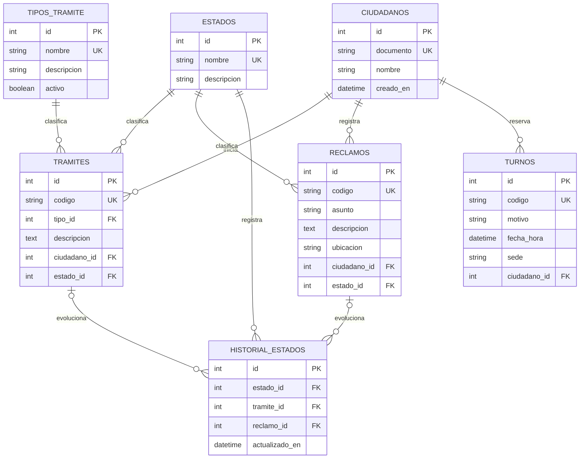

# Arquitectura técnica — Portal Ciudadano 0.1.0

## Componentes

```text
React PWA + Bootstrap (localhost:5174)
    ├── acceso de demostración DNI/CUIT
    ├── tablero de trámites, reclamos y turnos
    ├── formularios y consulta de seguimiento
    └── cliente HTTP
          └── FastAPI (127.0.0.1:8011)
                ├── catálogo de tipos de trámite y POST/GET trámites y reclamos
                ├── consulta y actualización de seguimiento e historial
                ├── reserva y consulta de turnos
                └── SQLAlchemy → backend/data/db/portal_ciudadano.db
```

## Modelo de datos



Un registro de historial referencia exactamente un trámite o un reclamo. Los estados de demostración son `Recibido`, `En Proceso` y `Resuelto`; la creación deja una primera entrada `Recibido`. El catálogo inicial de tipos contiene certificado de domicilio, habilitación comercial, libre deuda municipal y solicitud de poda. Se pueden seguir registrando tipos enviados por clientes API anteriores que todavía envíen el nombre en lugar de `tipo_id`.

## Contrato REST local

| Método | Ruta | Uso |
|---|---|---|
| `GET` | `/health` | Estado y versión del módulo. |
| `GET` | `/api/tipos-tramite` | Catálogo de tipos activos para iniciar un trámite. |
| `POST` | `/api/tipos-tramite` | Agrega un tipo al catálogo; rechaza nombres duplicados. |
| `POST` | `/api/reclamos` | Crea un reclamo, asigna código `REC-*` e inicia su historial. |
| `GET` | `/api/reclamos?documento={dni}` | Lista reclamos del documento indicado. |
| `POST` | `/api/tramites` | Inicia un trámite, asigna código `TRA-*` e inicia su historial. |
| `GET` | `/api/tramites?documento={dni}` | Lista trámites del documento indicado. |
| `GET` | `/api/seguimiento/{codigo}` | Devuelve el recurso y el historial de estados. |
| `PATCH` | `/api/seguimiento/{codigo}/estado` | Cambia a un estado existente y agrega una entrada de historial. Body: `{"estado":"En Proceso","observacion":"Asignado al área correspondiente."}`. |
| `POST` | `/api/turnos` | Reserva un turno con fecha/hora zonificada. |
| `GET` | `/api/turnos?documento={dni}` | Lista los turnos del documento indicado. |

Todas las cargas de ciudadanía validan DNI/CUIT sintético numérico de 7 a 11 dígitos. Los códigos alfanuméricos de seguimiento se generan en el servidor y tienen restricción de unicidad en SQLite. El alta de trámite acepta `tipo_id`; el campo `tipo` se mantiene para compatibilidad con clientes anteriores. FastAPI publica OpenAPI en `/docs`.

## Aislamiento y operación

- La base por defecto es `backend/data/db/portal_ciudadano.db`; `PORTAL_CIUDADANO_DATABASE_PATH` solo acepta rutas dentro del módulo o del directorio temporal de pruebas.
- No se comparten archivos de base, dependencias, modelos ni variables de conexión con otros módulos.
- SQLite activa claves foráneas y espera hasta 10 segundos ante bloqueos de escritura.
- La API limita CORS por defecto a `localhost:5174` y `127.0.0.1:5174`.
- El cliente PWA almacena solamente sus recursos estáticos; las respuestas API no se almacenan offline.

## Límites

El acceso DNI/CUIT es una simulación visual, no autenticación o autorización. La ruta de actualización de estados tampoco incorpora autorización y solo sirve para demostrar el flujo local; no publicar la API así. La ubicación se carga con coordenadas de ejemplo, no usa el GPS del dispositivo. No se envían solicitudes a sistemas municipales ni hay integración de pagos. Usar datos ficticios; antes de una exposición real, incorporar identidad, autorización, controles operativos y protección de datos.
