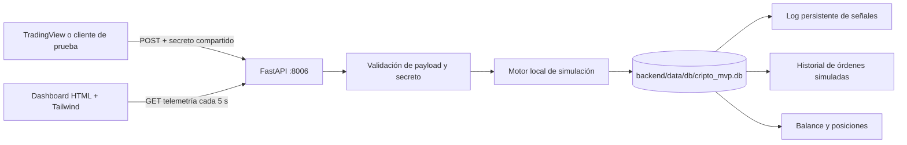

# Arquitectura — App Valentín Cripto 0.1.0

## Propósito y límites

Aplicación standalone de demostración que recibe alertas de TradingView, autentica cada webhook y simula operaciones localmente. Su UI, API y almacenamiento pertenecen exclusivamente a este módulo.

- No hay claves API reales de Binance ni de otros exchanges.
- No existe cliente, SDK ni conexión a un exchange; no se transmiten órdenes reales.
- Balance, posiciones, señales, órdenes y PnL son datos de simulación. No hay riesgo financiero ni asesoramiento de inversión.
- La autenticación del webhook no protege por sí sola el dashboard ni las rutas de lectura. El servicio se liga a loopback por defecto; no debe exponerse sin controles adicionales.
- La simulación no calcula comisiones, liquidez, margen, funding ni deslizamiento; take profit y stop loss solo quedan registrados.
- SQLite es para ejecución local de baja concurrencia; no se presenta como almacenamiento multiusuario o productivo.

## Componentes y flujo



FastAPI sirve la UI y la API desde el mismo origen. El almacenamiento usa únicamente `backend/data/db/cripto_mvp.db`, creada al iniciar el servicio. Cada señal autenticada, la orden resultante y el estado actualizado se escriben en una transacción SQLite. `event_id`, cuando se entrega, es único y evita reprocesar un reintento.

## Persistencia

| Tabla | Responsabilidad |
|---|---|
| `simulator_state` | Balance inicial y balance actual ficticios. |
| `signals` | Señales aceptadas sin secretos, estrategia, activo, acción, cantidad, precio y fecha. |
| `simulated_orders` | Resultado de cada orden simulada, PnL y balance posterior. |
| `positions` | Cantidad neta y precio de entrada promedio por símbolo. |

El estado y el historial sobreviven reinicios del proceso. No se crea un archivo de auditoría o base de datos alternativo. La base local está excluida del control de versiones.

## Contrato de API

Base local: `http://127.0.0.1:8006`.

| Método | Ruta | Respuesta / uso |
|---|---|---|
| `GET` | `/health` | Estado y versión `0.1.0`. |
| `GET` | `/` | Dashboard HTML. |
| `GET` | `/api/telemetry` | Estado, métricas, últimas 20 señales/órdenes y balance. |
| `GET` | `/api/simulator/balance` | Balance y posiciones persistidos. |
| `POST` | `/api/webhook/tradingview` | Webhook autenticado, simula una orden y responde `202`. |
| `GET` | `/docs` | OpenAPI de FastAPI. |

### `POST /api/webhook/tradingview`

El secreto se configura exclusivamente mediante `WEBHOOK_SECRET`, se recibe en `key` o `token` y se compara en tiempo constante. Ejemplo:

```json
{
  "key": "secreto-compartido",
  "event_id": "demo-001",
  "strategy": "Estrategia de prueba",
  "symbol": "BTCUSDT",
  "action": "buy",
  "quantity": 0.01,
  "price": 60000,
  "tp": 62000,
  "sl": 59000,
  "probability": 75
}
```

`quantity` admite el alias legado `"1"`. `event_id` es opcional y, si ya fue procesado, retorna `409`. Las credenciales incorrectas retornan `401`, el secreto sin configurar `503` y la entrada inválida `422`. Los secretos no se persisten ni aparecen en la respuesta.

## Ejecución y aislamiento

1. Crear un entorno virtual dentro de `backend/` e instalar `requirements.txt`.
2. Definir `WEBHOOK_SECRET` fuera del repositorio.
3. Ejecutar `uvicorn app.main:app --host 127.0.0.1 --port 8006` desde `backend/`.
4. El frontend consume únicamente los endpoints locales del mismo origen.

No usar varias instancias de esta aplicación contra una SQLite compartida en escenarios productivos. El hub y la documentación central describen un subsistema de portfolio separado; este módulo no depende de la landing ni de bases de otros MVP.

## Árbol

```text
app-valentin-cripto/
├── VERSION
├── README.md
├── docs/ARCHITECTURE.md
├── backend/
│   ├── requirements.txt
│   ├── requirements-dev.txt
│   ├── app/
│   │   ├── database.py
│   │   ├── main.py
│   │   └── simulator.py
│   ├── data/db/.gitkeep
│   └── tests/test_app.py
└── frontend/dashboard.html
```
