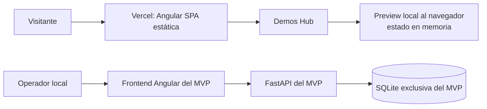

# Manual de trabajo para MVPs Angular

**Estándar operativo de arquitectura, desarrollo, preview y versionado del portfolio Ideal-IT**

| Campo | Definición |
|---|---|
| Alcance | Nuevos MVPs Angular y adaptación de módulos existentes |
| Referencia de implementación | MVP Formularios v0.1.2 |
| Landing | `ideal-it-portfolio/` — Angular standalone, Tailwind CSS y Vercel |
| Ejemplo de subsistema local | `mvp-formularios/` — Angular standalone, Bootstrap, FastAPI y SQLite |
| Índice canónico del portfolio | `PORTFOLIO_HUB.md` en la raíz del monorepo |

---

## 1. Propósito y principios no negociables

Este manual define cómo crear, adaptar y presentar un MVP Angular en Ideal-IT. El objetivo es que un módulo pueda ejecutarse y evolucionar localmente sin depender de la landing ni de otros MVPs, mientras que Demos Hub puede mostrar una preview pública segura y demostrativa.

Los siguientes principios son obligatorios:

1. **Cada MVP es un subsistema autónomo.** Tiene aplicación, configuración, dependencias, API, modelos, pruebas, documentación y persistencia propios.
2. **La landing presenta; no hospeda el backend del MVP.** La SPA publicada en Vercel no contiene ni ejecuta FastAPI ni SQLite.
3. **No se comparten bases ni servicios de dominio entre MVPs.** Ningún módulo lee o escribe la SQLite de otro, importa sus modelos, reutiliza sus sesiones de SQLAlchemy ni depende de sus endpoints internos.
4. **La preview no es el producto local.** Si no hay un backend público aprobado, la preview usa datos demostrativos efímeros y nunca intenta llamar a `localhost`, una base local ni una API privada.
5. **Las afirmaciones de la UI deben ser explícitas.** Si una operación es simulada, el usuario debe saberlo. Una ilustración de QR, un dato mock o una operación en memoria no se presenta como un proceso productivo.
6. **Cambios pequeños y verificables.** Antes de editar, revisar estado Git, convenciones del módulo y superficies afectadas. No incluir cambios ajenos ni usar `git add .` como atajo.

## 2. Arquitectura y aislamiento estricto

### 2.1 Dos superficies, dos responsabilidades

El monorepo contiene por separado:

- **Subsistemas locales `mvp-*`:** frontends Angular de ejecución local y backends FastAPI. Persisten datos en una base SQLite exclusiva dentro de su módulo.
- **Landing `ideal-it-portfolio`:** SPA de presentación y Demos Hub. Puede incluir previews autónomas de interfaz, pero no incorpora el runtime, la DB o los modelos del backend local.



No existe una conexión entre Preview y API: son experiencias separadas. La preview puede ilustrar el mismo proceso de negocio con estados ficticios, no consumir la API local.

### 2.2 Reglas de aislamiento

Para cada MVP:

- Ubicar la base por defecto dentro de su propia carpeta, por ejemplo `mvp-nuevo/backend/data/db/nuevo_mvp.db`.
- Configurar un nombre de variable de entorno exclusivo, como `NUEVO_MVP_DATABASE_PATH`. Cambiar la ruta no debe permitir conectar accidentalmente otra aplicación al archivo de DB de un módulo distinto.
- Definir sus propios modelos ORM, `Base`, motor, sesión, esquema, routers, servicios y migraciones.
- Habilitar claves foráneas en **cada conexión SQLite** con `PRAGMA foreign_keys=ON`; configurar también un tiempo de espera razonable para bloqueos.
- No guardar la base generada, documentos cargados, secretos, `.venv`, `node_modules`, compilados o cachés en Git. Ignorar específicamente artefactos locales; no ignorar documentos fuente requeridos por el build.
- Limitar CORS a los orígenes locales del frontend de ese MVP. No abrir `allow_origins=["*"]` por conveniencia.
- Evitar referencias `../mvp-otro/...`, importaciones desde otro MVP, conexiones a servicios de otro puerto o configuración que comparta datos.
- No agregar URLs, credenciales, secretos o información personal real a los bundles de Angular o a la preview.

Una integración entre productos que más adelante sea necesaria requiere un contrato de servicio explícito, aprobación arquitectónica, autenticación, permisos y documentación. **No se resuelve compartiendo SQLite ni importando código de dominio.**

### 2.3 Convención de carpetas

Estructura recomendada para un nuevo módulo:

```text
mvp-nuevo/
├── VERSION
├── README.md
├── .gitignore
├── backend/
│   ├── requirements.txt
│   ├── requirements-dev.txt
│   ├── app/
│   │   ├── main.py
│   │   ├── models.py
│   │   ├── schemas.py
│   │   ├── core/
│   │   │   ├── config.py
│   │   │   └── database.py
│   │   ├── routers/
│   │   └── services/
│   ├── data/
│   │   └── db/                   # DB local generada; no se versiona
│   └── tests/
└── frontend/
    ├── package.json
    ├── angular.json
    └── src/
        └── app/
            ├── core/             # Tipos, servicios HTTP y configuración local
            └── features/         # Componentes standalone por capacidad
```

La estructura puede variar si la complejidad lo justifica, pero backend, frontend, datos, configuración y pruebas deben permanecer identificables y aislados.

## 3. Stack y convenciones de UI

### 3.1 Angular standalone

- Implementar componentes standalone; no crear NgModules para un módulo nuevo salvo una limitación concreta y documentada de una dependencia.
- Usar rutas lazy cuando el módulo tenga más de una vista o su preview no deba aumentar el bundle inicial de la landing.
- Agrupar por capacidad de negocio: `features/gestion-eventos/`, `features/portal-ciudadano/`, etc.; evitar componentes monolíticos y carpetas organizadas solo por tipo técnico.
- Mantener modelos TypeScript explícitos para requests y responses. Evitar `any`, respuestas ambiguas y datos de frontend que no coincidan con el contrato API.
- Centralizar HTTP en servicios Angular (`HttpClient`); los componentes manejan estado de UI y delegan el transporte al servicio.
- Mostrar estados de carga, vacío, éxito y error. Los errores HTTP no se convierten silenciosamente en resultados de éxito ni se ocultan con datos por defecto.
- Si una vista procesa información personal o permite acciones relevantes, definir su límite de demo y usar exclusivamente datos sintéticos.

### 3.2 Bootstrap y Tailwind son alternativas, no un mandato de mezclar

El stack visual del frontend local se elige de acuerdo con el objetivo del MVP:

- **Bootstrap:** adecuado cuando el objetivo incluye demostrar componentes UI listos, formularios, grillas o una identidad visual distinta. Importar estilos y componentes solo en el frontend que lo usa.
- **Tailwind CSS:** adecuado para composición de utility classes y alineación con la landing existente.
- **CSS local / componentes standalone:** válido para un alcance pequeño si mantiene accesibilidad, consistencia y estilos encapsulados.

No añadir Bootstrap a la landing solo porque el MVP local lo usa. La landing actual usa Angular standalone + Tailwind; Formularios local usa Angular standalone + Bootstrap. La preview de Formularios sigue el diseño Tailwind existente y no importa el Bootstrap ni el código Angular del subsistema local.

Documentar las decisiones de estilo y dependencias en el README del módulo. Evitar instalar librerías duplicadas para lograr un efecto visual que el stack actual ya puede resolver.

## 4. Puertos locales

Los puertos son una convención de desarrollo local para permitir correr subsistemas en paralelo; no representan una integración ni un despliegue público.

| Superficie | Puerto sugerido | Uso |
|---|---:|---|
| Landing Angular | `4200` | Demos Hub y previews en Vercel/local |
| API MVP Personal | `8001` | FastAPI local |
| API MVP Auditoría | `8002` | FastAPI local |
| API MVP Formularios | `8003` | FastAPI local |
| API Service Synthetic Factory | `8009` | FastAPI local aislada |
| API siguiente MVP | `8004` en adelante | Reservar un puerto libre y anotarlo en su README |
| Frontend de MVP local | `4201` en adelante | Reservar un puerto libre, separado de la landing |
| UI Service Synthetic Factory | `4209` | React/Vite local aislada |

Antes de asignar un puerto, revisar los módulos existentes y el estado del equipo. No asumir que una convención de ejemplo tiene precedencia sobre un conflicto real. Registrar el par frontend/API en `README.md`, CORS y configuración del cliente HTTP.

## 5. Workflow de un nuevo MVP

### Paso 1 — Acordar alcance y crear un módulo aislado

1. Confirmar el caso de uso, entidades, usuarios, datos sensibles, límites de la demo, integraciones y necesidad de preview.
2. Revisar la raíz Git y el estado de trabajo antes de editar:

   ```powershell
   Set-Location C:\Users\usuario\Desktop\Ideal-IT
   git rev-parse --show-toplevel
   git status --short --branch
   ```

3. Crear el directorio independiente `mvp-nuevo/` en la raíz del monorepo. No trasladar backend ni SQLite a `ideal-it-portfolio`.
4. Acordar los puertos de API y frontend, el nombre del archivo SQLite y la variable de entorno exclusiva.
5. Añadir a `.gitignore` las DB generadas, entornos virtuales, `node_modules`, artefactos y secretos sin modificar ni borrar datos preexistentes.

### Paso 2 — Configurar FastAPI, SQLAlchemy y SQLite

1. Crear la aplicación `backend/app/main.py`; definir lifespan/startup, CORS local y ruta `/health` con nombre y versión del módulo.
2. Implementar una configuración centralizada que resuelva la ruta por defecto relativa a la carpeta backend, no al directorio desde donde se ejecuta el comando:

   ```text
   backend/data/db/nuevo_mvp.db
   ```

3. Permitir un override mediante variable exclusiva; crear la carpeta padre antes de abrir el motor.
4. Crear un único `DeclarativeBase` del módulo, modelos con restricciones y relaciones explícitas, y un motor SQLAlchemy con claves foráneas SQLite habilitadas por conexión.
5. Exponer sesiones mediante una dependencia FastAPI con cierre garantizado (`yield` y context manager).
6. Separar routers, esquemas Pydantic, servicios de negocio y persistencia. Los routers validan entradas y expresan errores HTTP adecuados; el servicio contiene reglas de negocio.
7. Crear o evolucionar el esquema de forma reproducible. `metadata.create_all` sirve para un MVP pequeño inicial; al introducir cambios de esquema con datos persistentes, diseñar una migración versionada (por ejemplo, Alembic) en lugar de suponer que `create_all` modifica tablas existentes.
8. Añadir pruebas API que apunten a una DB temporal por prueba, no a la SQLite de desarrollo:

   ```powershell
   cd mvp-nuevo\backend
   py -m venv .venv
   .\.venv\Scripts\Activate.ps1
   pip install -r requirements-dev.txt
   py -m pytest
   ```

9. Probar reglas normales y límites: identificadores duplicados, relaciones inexistentes, valores fuera de dominio, cupos, permisos, estados inválidos y aislamiento de DB. No validar solo que `/health` responde.

**Mínimo de backend:** `requirements.txt`, `requirements-dev.txt`, configuración aislada, CORS explícito, health check, modelos, esquema de requests/responses, routers, pruebas y documentación OpenAPI accesible localmente.

### Paso 3 — Estructurar Angular local

1. Crear el frontend Angular standalone dentro de `mvp-nuevo/frontend/`. Usar la versión de Angular compatible con el estándar vigente y fijar rangos de dependencias en el manifiesto/lockfile del propio frontend.
2. Habilitar rutas y `provideHttpClient()` si la UI consume FastAPI. Configurar API base URL local en un solo lugar.
3. Crear modelos TypeScript que representen el contrato del backend; mantener las traducciones entre nombres de campos solo donde haya una razón documentada.
4. Implementar servicios HTTP por capacidad y funcionalidades Angular en componentes standalone.
5. No incrustar datos personales, secretos, valores de producción o ejemplos aparentemente reales. Los fixtures deben estar identificados como ficticios.
6. Ejecutar backend y frontend de manera independiente. Ejemplo:

   ```powershell
   # Terminal API, desde mvp-nuevo\backend
   uvicorn app.main:app --reload --port 8004

   # Terminal UI, desde mvp-nuevo\frontend
   npm install
   npm start
   ```

7. Verificar que la UI llama exclusivamente al backend local de ese módulo, que el manejo de errores es visible y que el CORS coincide con el origen real de desarrollo.

### Paso 4 — Preparar preview en Demos Hub si corresponde

La preview es opcional; se implementa solo si la landing necesita mostrar un flujo sin backend público.

1. Crear un feature propio bajo `ideal-it-portfolio/src/app/features/nuevo-preview/`. No importar componentes, servicios o modelos de dominio desde `mvp-nuevo/`.
2. Modelar unos pocos casos demostrativos en memoria del componente/servicio exclusivo de la landing. No usar `localStorage` salvo que persistencia de navegador sea intencional y se documente; el patrón preferido es reiniciar la demo al recargar.
3. Simular explícitamente cada operación: publicación, inscripción, aprobación/rechazo, aforo y confirmación de asistencia según aplique. Un control que no tenga comportamiento debe identificarse como prototipo, no aparentar funcionar.
4. No generar una representación visual engañosa. Por ejemplo, si el QR no está codificado por una biblioteca y no puede escanearse, rotularlo “ilustrativo/no escaneable”.
5. Mostrar permanentemente o cerca de la interacción que los datos son ficticios, efímeros y no se envían a ningún backend.
6. Añadir una ruta lazy, por ejemplo `/mvp/nuevo`, y un enlace desde el detalle de la tarjeta del Demos Hub.
7. Añadir pruebas que cubran el flujo principal y sus reglas relevantes. No añadir Bootstrap/Tailwind u otra dependencia de MVP a la landing sin motivo arquitectónico.
8. Verificar navegación directa y refresco de la ruta SPA. Comprobar `vercel.json` existente antes de cambiarlo; no duplicar rewrites ya correctos.

El cliente de la preview **no** debe:

- Llamar a `http://localhost`, `127.0.0.1`, una IP privada o una URL ficticia de FastAPI.
- Intentar leer la SQLite, compartir las sesiones del MVP o cargar el bundle del frontend local.
- Afirmar que los cambios en memoria persistieron, que un QR ilustrativo es válido o que una asistencia fue registrada por el backend.
- Recopilar credenciales o información personal para “hacer real” la interacción.

### Paso 5 — Versionar y documentar el módulo

1. Crear `VERSION` en la raíz del MVP con **una sola línea**, versión semántica sin prefijo `v`, salto de línea final permitido. Para la línea de Formularios documentada aquí, el contenido es:

   ```text
   0.1.2
   ```

2. `0.1.2` describe la versión actual de MVP Formularios y es referencia del estado existente; **no obliga a congelar esa versión en nuevos productos**. Cada módulo nuevo empieza en la versión acordada para su entrega y cambia de forma independiente siguiendo SemVer:
   - `PATCH`: corrección compatible.
   - `MINOR`: funcionalidad nueva compatible.
   - `MAJOR`: cambio incompatible de contrato o comportamiento.
3. La versión de la API, el archivo `VERSION`, la UI, `README`, `ARCHITECTURE.md` y catálogo deben ser coherentes. No aumentar la versión si no existe un cambio deliberado, y no mantener una versión hardcodeada en múltiples lugares si puede exponerse desde una única constante/endpoint con coherencia verificable.
4. El `README.md` del módulo explica requisitos, instalación, comandos, puertos, variable de ruta DB, URL `/docs`, pruebas, funcionalidades, privacidad y límites de la simulación.
5. `docs/ARCHITECTURE.md` documenta versión/changelog, componentes, tecnologías, entidades y relaciones, restricciones, endpoints, CORS, puertos, DB, migraciones y aislamiento. Para modelos relacionales incluir un diagrama ERD Mermaid que corresponda a los modelos reales.
6. Si se presenta en Demos Hub, añadir también la descripción técnica y límites de la preview en el README de la landing.

### Paso 6 — Actualizar el portfolio

`PORTFOLIO_HUB.md` de la raíz del monorepo (`Ideal-IT/PORTFOLIO_HUB.md`) es el índice canónico general. Para cada módulo añadir o actualizar:

- Nombre y versión.
- Frontend, tecnologías de UI, backend y almacenamiento.
- Estado/despliegue: local standalone, preview de landing u otro destino efectivamente configurado.
- Casos de uso demostrables y límites relevantes.
- Enlaces relativos a README y arquitectura del MVP.

Si el repositorio conserva una copia del catálogo en `ideal-it-portfolio/PORTFOLIO_HUB.md`, mantenerla sincronizada cuando la tarea la incluya. No describir como despliegue público una preview en memoria ni como backend remoto una API local. No registrar URL de preview hasta que exista una URL desplegada verificable.

### Paso 7 — Validar y preparar cambios

Antes de dar por terminado el módulo:

1. Ejecutar pruebas de API con DB temporal.
2. Ejecutar build del frontend standalone.
3. Ejecutar build de la landing y `npm test -- --watch=false` si se cambió una preview, route o tarjeta.
4. Probar el flujo en navegador y ruta directa (`/mvp/nuevo`) localmente.
5. Verificar:
   - Una sola DB en la ruta dedicada y tablas esperadas.
   - CORS del frontend del módulo, no de la landing.
   - Sin errores de consola/build y sin URLs backend desde la preview.
   - Contratos/documentación/versiones sincronizados.
   - Archivos de build, bases, `.env`, `.venv`, `node_modules` y artefactos privados fuera del commit.
6. Revisar `git diff --check`, `git status --short` y la lista de archivos staged. Añadir con `git add -- <rutas-específicas>`; **no usar `git add .` en un workspace compartido o con contenido ajeno sin revisar**.
7. Commit y push son acciones separadas de la implementación: realizarlas únicamente cuando estén solicitadas o aprobadas y solo con los archivos del alcance.

## 6. Integración de la preview con Demos Hub

### 6.1 Catálogo y navegación

El catálogo vive en el servicio de datos del hub (`core/services/demo-data.service.ts`) y usa el tipo `Demo` (`core/models/demo.model.ts`). Si se habilita una preview:

- Agregar una propiedad opcional de ruta (`previewPath`) en el tipo.
- Configurar esa ruta para el MVP correspondiente.
- Mantener `status` como MVP local si el backend real sigue sin publicar; una preview en memoria **no convierte** el producto en una demo live.
- Exponer la ruta desde el detalle de la tarjeta, no cambiar inadvertidamente la navegación existente de otros módulos.
- Agregar ruta lazy en `app.routes.ts`, una prueba de ruta y pruebas del enlace del detalle.
- Preservar el rewrite SPA de Vercel: `/mvp/nuevo` debe servir el `index.html` para que Angular resuelva la ruta tanto en navegación como al refrescar.

### 6.2 Lógica que se puede simular

La preview puede implementar un flujo de presentación autocontenido:

```text
Estado inicial ficticio
  → interacción del visitante
  → actualización del estado local de memoria
  → mensaje explícito de resultado simulado
```

Ejemplos:

- Evento nuevo: agregarlo a un arreglo en memoria y mostrarlo en portal.
- Solicitud: validar forma de entrada, comprobar cupo y DNI duplicado, y crear estado pendiente o aprobado.
- Aprobación: cambiar estado ficticio y generar un identificador de demostración no válido en producción.
- Rechazo: actualizar estado y liberar cupo de acuerdo con las reglas definidas.
- Asistencia: validar un identificador generado por la preview y bloquear una segunda confirmación.

La preview debe permitir explorar el flujo y comunicar el modelo mental del producto, pero no reemplaza las reglas atómicas del backend. Los límites de cupo, unicidad, autenticación, autorización, durabilidad y concurrencia del producto real deben validarse en FastAPI.

### 6.3 Presentación y privacidad

- Rotular el módulo como **Preview**, **Simulación** o **Datos de ejemplo** en la interfaz.
- Usar datos ficticios; no copiar registros de clientes ni archivos de la aplicación fuente.
- Indicar cuándo la pantalla se reinicia y si los cambios no persisten.
- No pedir DNI, email u otros datos reales si la interacción puede hacerse con valores de ejemplo; si hay campos para demostrar un formulario, señalar que se deben usar datos ficticios.
- No abrir cámara, generar archivos descargables ni enviar emails como si fueran operaciones reales salvo que ese comportamiento esté implementado y aprobado expresamente para la landing.
- No incluir código de QR ornamental que pueda confundirse con un pase validable. Diferenciar texto token simulado de una imagen QR auténtica.
- Mantener accesibilidad: label/inputs, botones de tipo correcto, mensajes con `role="status"` o `role="alert"`, contraste, foco visible y navegación por teclado.

## 7. FastAPI y contrato API

Las siguientes convenciones guían la API local:

- Un endpoint de health con nombre de módulo y versión.
- Prefijo `/api` para recursos, nombres y respuestas consistentes con `ARCHITECTURE.md`.
- Requests y responses validados con Pydantic; límites explícitos de longitud, valores y tipos.
- Respuestas HTTP significativas: `201` al crear, `404` para entidad inexistente, `409` para conflicto de dominio, `422` para payload inválido y `204` para borrado sin body si corresponde.
- Errores accionables, sin capturas generales que devuelvan una respuesta de éxito vacía.
- Reglas críticas —aforo, unicidad, estado de aprobación, cambios duplicados— protegidas también en backend/DB, no solo en Angular.
- Índices en columnas de búsqueda/FK cuando el volumen lo justifica; `UNIQUE`, `CHECK`, FK y nulabilidad en DB para reglas que deben sobrevivir a diferentes clientes.
- No afirmar autenticación o autorización en un MVP que carece de ellas. Si la demo local no incorpora usuarios, indicarlo como limitación.

## 8. Persistencia, privacidad y cambios de esquema

La SQLite local facilita el desarrollo aislado; no es automáticamente apropiada como almacenamiento compartido para una landing pública o un servicio serverless multiinstancia.

- No desplegar la SQLite del MVP en Vercel ni almacenarla en el filesystem efímero de una función serverless.
- Si el producto deja de ser local y necesita persistencia accesible por múltiples usuarios, abrir una decisión arquitectónica separada: hospedaje del backend, DB gestionada, autenticación, respaldos, secretos, red, migraciones, monitoreo y política de datos. No convertir la preview en backend improvisadamente.
- Aplicar minimización: solicitar solo datos imprescindibles. Usar sintéticos en fixtures y pruebas; no introducir datos personales reales en commits, logs o capturas.
- No registrar tokens QR, credenciales o payloads sensibles en logs. Rotar o invalidar credenciales ante exposición.
- Restringir formatos y tamaños de uploads; guardar archivos fuera del árbol estático ejecutable, generar nombres desde el servidor y validar rutas de descarga.
- Antes de cambiar el esquema existente, evaluar compatibilidad con la DB de desarrollo y datos persistentes. Para cambios destructivos, respaldar, migrar y probar con una copia; no eliminar la SQLite como método de “arreglo”.

## 9. Lista de comprobación de salida

### Subsistema local

- [ ] Directorio propio `mvp-nuevo/`, frontend y backend identificables.
- [ ] Frontend Angular standalone con stack visual documentado.
- [ ] API FastAPI con routers, schemas, servicios, CORS local y health/version.
- [ ] SQLite exclusiva dentro de `backend/data/db/`; FK activas por conexión.
- [ ] Variable de ruta con prefijo/nombre exclusivo del módulo.
- [ ] Pruebas API usando una DB temporal.
- [ ] Reglas de negocio relevantes en servidor/DB y errores HTTP explícitos.
- [ ] `VERSION`, `README.md` y `docs/ARCHITECTURE.md` coherentes.
- [ ] Dependencias y comandos reproducibles, sin secretos o datos reales.

### Landing / preview, si aplica

- [ ] Feature de preview separado y cargado mediante ruta Angular lazy.
- [ ] Acceso desde la tarjeta/detalle de Demos Hub.
- [ ] Datos ficticios exclusivamente en memoria, salvo decisión documentada distinta.
- [ ] Sin importaciones del backend ni llamadas a localhost, DB o servicio no aprobado.
- [ ] Mensajes claros de simulación, ausencia de persistencia y límites de QR/cámara.
- [ ] Pruebas del flujo, rechazo/aprobación, cupo y duplicados aplicables.
- [ ] Ruta directa/refresh SPA probada; `vercel.json` revisado sin duplicar rewrites.
- [ ] README de landing y catálogo del portfolio describen correctamente la preview.

### Revisión y entrega

- [ ] Build Angular del MVP local y build de landing cuando corresponda.
- [ ] Pruebas backend y pruebas frontend configuradas.
- [ ] Verificación manual/navegador de la ruta y los flujos principales.
- [ ] `git diff --check` sin errores.
- [ ] Staging selectivo revisado; DBs, dependencias instaladas y cambios ajenos fuera.
- [ ] Commit/push solo con alcance solicitado y branch/remoto verificados.

## 10. Versiones, documentación y fuentes de referencia

El estado inicial de Formularios y su implementación local están descritos en:

- [`mvp-formularios/README.md`](../../mvp-formularios/README.md) — requisitos, ejecución y privacidad.
- [`mvp-formularios/docs/ARCHITECTURE.md`](../../mvp-formularios/docs/ARCHITECTURE.md) — ERD, endpoints y componentes.
- [`ideal-it-portfolio/PORTFOLIO_HUB.md`](../PORTFOLIO_HUB.md) — catálogo de esta landing.
- [`PORTFOLIO_HUB.md`](../../PORTFOLIO_HUB.md) — matriz canónica del monorepo, si está presente en la raíz.

Estas referencias complementan el manual: si una implementación cambia, actualizar sus fuentes concretas y mantener consistentes las rutas, puertos, versiones y capacidades publicadas.
