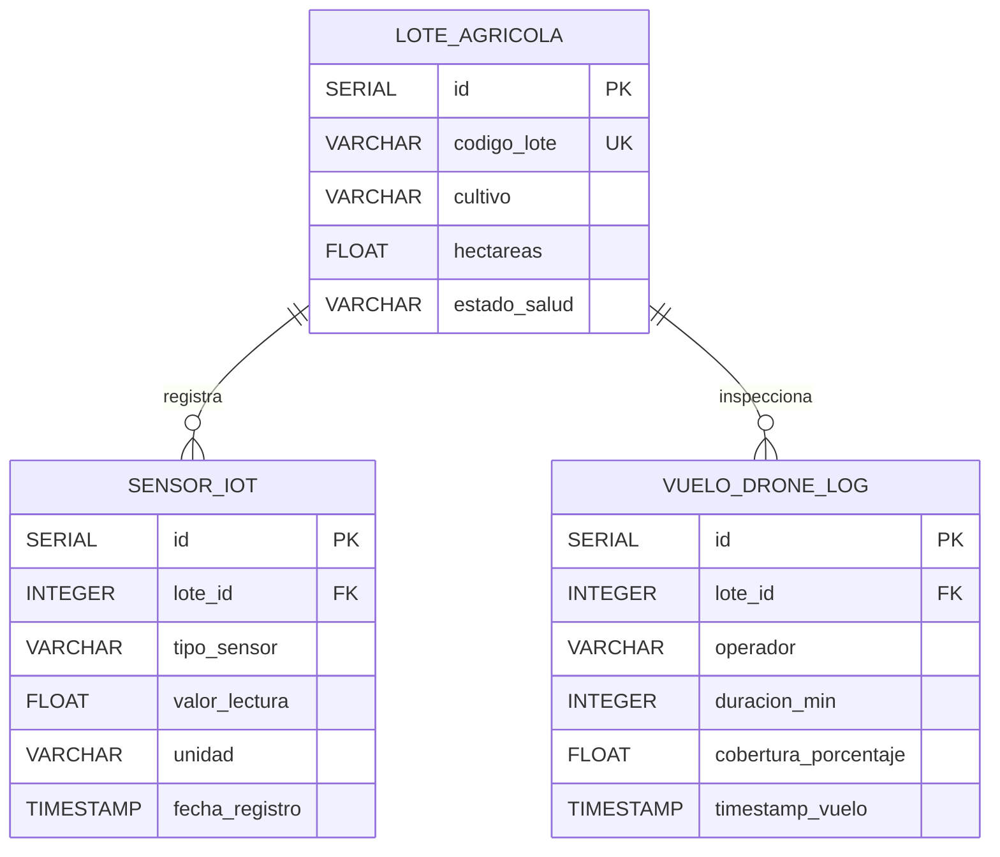
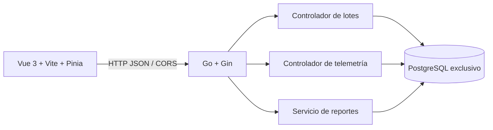

# Arquitectura técnica — MVP AgroTech Smart Crop & Drone Telemetry v0.1.1

## Changelog v0.1.1

- Se crea el séptimo subsistema solicitado como aplicación local independiente con Vue 3, Vite, Go/Gin y PostgreSQL.
- Se definen las entidades de lotes agrícolas, sensores IoT y vuelos de drones, con claves foráneas, restricciones e índices de consulta temporal.
- Se incorporan ABM de lotes, ingesta transaccional por lotes, dashboard, CORS acotado y exportación CSV/PDF.
- Se calcula el estado hídrico con la lectura de humedad más reciente registrada: `<=20%` crítico, `<=35%` alerta y `>35%` óptimo.

## Componentes y ERD



`lote_agricola` restringe el estado a `OPTIMO`, `ALERTA_HIDRICA` o `CRITICO`. `sensor_iot.tipo_sensor` acepta `HUMEDAD_SUELO`, `TEMPERATURA_AMBIENTE` o `NDVI_DRONE`. Las referencias usan `ON DELETE CASCADE`, para que la baja explícita de un lote elimine sus registros dependientes. Los índices ordenados por lote y fecha sostienen consultas recientes de telemetría.

## Componentes y aislamiento



El esquema se crea de forma idempotente al iniciar el backend. El pool limita conexiones abiertas a 25 y ociosas a 10, verifica conexión con timeout y crea índices. No se conecta a servicios externos de mapas, drones o sensores. El CORS por defecto permite solo `http://localhost:5173`; `CORS_ORIGIN` permite indicar un origen explícito.

## Contratos de API

Base local predeterminada: `http://localhost:8080`. Los cuerpos usan JSON salvo las descargas de reportes.

| Método | Ruta | Entrada / respuesta |
|---|---|---|
| `GET` | `/health` | Estado del proceso y PostgreSQL; responde `503` si la base no está disponible. |
| `GET` | `/api/lotes` | Lista lotes e incluye `humedad_actual` si hay una lectura registrada. |
| `POST` | `/api/lotes` | Alta con `codigo_lote`, `cultivo`, `hectareas` positivas. Devuelve `201`; código duplicado `409`. |
| `PUT` | `/api/lotes/:id` | Actualiza `codigo_lote`, `cultivo`, `hectareas` y `estado_salud`. |
| `DELETE` | `/api/lotes/:id` | Elimina lote y registros vinculados; devuelve `204` o `404`. |
| `POST` | `/api/telemetry/ingest` | Ingesta atómica de `lecturas` y/o `vuelos`, máximo combinado 1000. |
| `GET` | `/api/telemetry?lote_id=1&limit=100` | Lecturas recientes; `limit` predeterminado 100 y máximo 500. |
| `GET` | `/api/dashboard` | Lotes, humedad reciente, vuelos registrados y resumen de superficie/alertas. |
| `GET` | `/api/reports/export?format=csv` | Descarga reporte analítico CSV; `format=pdf` genera PDF. |

### Ingesta

Ejemplo con una medición y un vuelo en una única transacción:

```json
{
  "lecturas": [
    {
      "lote_id": 1,
      "tipo_sensor": "HUMEDAD_SUELO",
      "valor_lectura": 28.5,
      "unidad": "%",
      "fecha_registro": "2026-10-31T12:00:00Z"
    }
  ],
  "vuelos": [
    {
      "lote_id": 1,
      "operador": "Equipo de campo",
      "duracion_min": 18,
      "cobertura_porcentaje": 92.4,
      "timestamp_vuelo": "2026-10-31T12:10:00Z"
    }
  ]
}
```

Las fechas son RFC3339/JSON `time`; si se omiten, se asigna el instante actual UTC. Las lecturas de humedad deben estar entre 0 y 100; NDVI entre -1 y 1; duración de vuelo positiva y cobertura entre 0 y 100. Un lote inexistente devuelve `400`; cualquier fallo cancela toda la transacción y evita respuestas exitosas parciales. La política de estado aplica la lectura cronológicamente más reciente, sin permitir que una lectura atrasada reemplace una lectura de fecha posterior.

### Reportes

El reporte contiene código y cultivo, hectáreas, estado, humedad más reciente, cantidad de lecturas, cantidad de vuelos y cobertura promedio. Los errores de consulta/generación responden `500`; un formato no soportado responde `400`. Los archivos se generan en memoria y no se guardan en disco.

## Estados de dominio

- Estado del lote: `OPTIMO`, `ALERTA_HIDRICA`, `CRITICO`.
- Tipos de sensor: `HUMEDAD_SUELO`, `TEMPERATURA_AMBIENTE`, `NDVI_DRONE`.
- Límites de salud: crítico `<=20%`; alerta `>20% y <=35%`; óptimo `>35%`.

## Árbol del módulo

```text
mvp-agrotech-iot/
├── VERSION
├── README.md
├── docs/ARCHITECTURE.md
├── backend/
│   ├── go.mod
│   ├── main.go
│   ├── config/database.go
│   ├── models/agrotech.go
│   ├── controllers/
│   │   ├── export_controller.go
│   │   ├── lotes_controller.go
│   │   └── telemetry_controller.go
│   └── services/export_service.go
└── frontend/
    ├── package.json
    ├── vite.config.js
    └── src/
        ├── App.vue
        ├── components/
        ├── stores/agrotech.js
        └── views/AgroDashboard.vue
```
