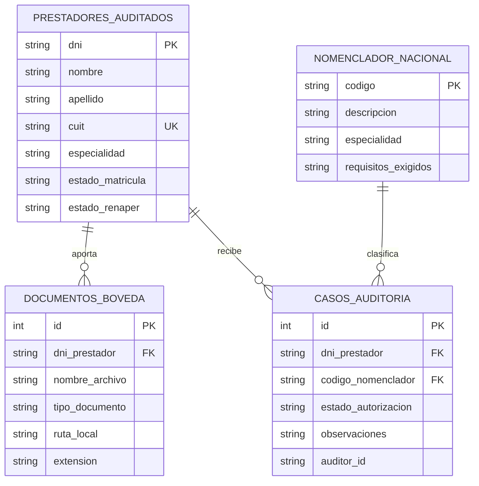

# Arquitectura técnica — MVP Auditoría v0.1.1

## Vista de componentes

```text
Angular standalone (localhost:4201)
    └── cliente HTTP Auditoría
          └── FastAPI local (localhost:8002)
                ├── routers: boveda, validaciones, nomenclador, casos
                ├── service: audit_service
                ├── SQLAlchemy → backend/data/db/auditoria_mvp.db
                └── archivos → backend/data/storage/
```

## Entidad-relación de `auditoria_mvp.db`



Las decisiones admitidas son `APROBADO`, `RECHAZADO` y `PENDIENTE`. Solo el servicio local autoriza; para aprobar exige prestador con matrícula `ACTIVA`, RENAPER `VALIDADO` y documentos que correspondan a requisitos textuales reconocidos (orden, informe, certificado, historia clínica o documento). El rechazo no depende de la validación para permitir registrar el criterio del auditor.

## Contratos de API REST

Base local: `http://127.0.0.1:8002`. Todos los recursos de dominio están prefijados con `/api`.

| Método | Ruta | Uso |
|---|---|---|
| `GET` | `/health` | Estado y versión. |
| `GET`, `POST` | `/api/validaciones/prestadores` | Lista prestadores o crea un prestador de prueba. |
| `GET` | `/api/validaciones/renaper/{dni}` | Resultado mock local de identidad. |
| `GET` | `/api/validaciones/matricula/{dni}` | Resultado mock local de matrícula. |
| `GET` | `/api/boveda?dni_prestador=...` | Lista documentos, opcionalmente por prestador. |
| `POST` | `/api/boveda` | Guarda archivo PDF/JPEG/PNG codificado en Base64 y sus metadatos. |
| `GET` | `/api/boveda/{id}/contenido` | Sirve el archivo local en línea para previsualización. |
| `GET` | `/api/nomenclador?especialidad=...&q=...` | Filtra el catálogo local. |
| `POST` | `/api/nomenclador` | Añade un código al catálogo local. |
| `GET` | `/api/casos` | Lista casos, opcionalmente por prestador. |
| `POST` | `/api/casos` | Abre un caso en estado `PENDIENTE`. |
| `PATCH` | `/api/casos/{id}` | Resuelve un caso o actualiza observaciones/auditor. |

El alta de prestador acepta `dni`, `nombre`, `apellido`, `cuit` y `especialidad`; los estados mock pueden definirse inicialmente como `estado_matricula` (`ACTIVA`/`INACTIVA`) y `estado_renaper` (`VALIDADO`/`NO_VALIDADO`). La carga documental acepta `dni_prestador`, `nombre_archivo`, `tipo_documento` y `contenido_base64`; límite 15 MiB por archivo. Solo se admiten extensiones PDF, PNG y JPG/JPEG. La nomenclatura acepta `codigo`, `descripcion`, `especialidad` y `requisitos_exigidos`.

## Aislamiento

- Cada módulo se ejecuta en puertos separados, mantiene su aplicación FastAPI, frontend, entorno Python y SQLite. Auditoría usa `backend/data/db/auditoria_mvp.db`; no lee ni comparte `personal_mvp.db`.
- La SQLite aplica claves foráneas. El valor de ruta de documento se genera por el servidor, y el endpoint de contenido limita la lectura a la carpeta de almacenamiento del módulo.
- Los únicos orígenes CORS habilitados son localhost/127.0.0.1 del frontend Auditoría (`4201`).
- No hay integración con bases corporativas, proveedores de nube, RENAPER real, matrículas reales ni endpoints remotos. La UI usa exclusivamente la API local.
