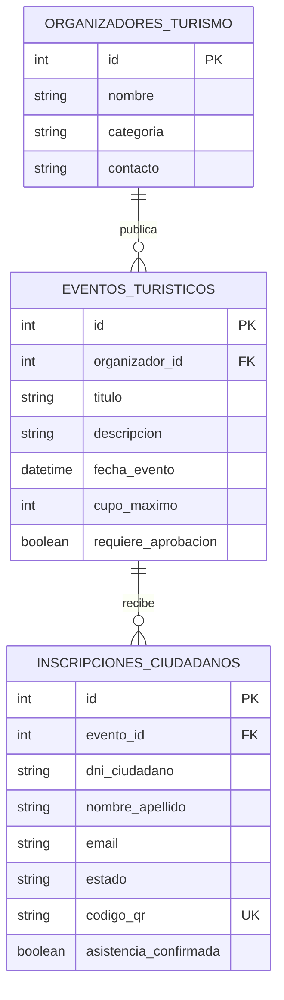

# Arquitectura técnica — MVP Formularios v0.1.2

## Changelog v0.1.2

- Se restringe la ruta configurable de SQLite al módulo o al directorio temporal de pruebas para evitar compartir bases entre subsistemas.

## Changelog v0.1.1

- Se crea el subsistema local de Turismo y Eventos Municipales con Angular standalone + Bootstrap y FastAPI.
- Se aísla la persistencia en `backend/data/db/formularios_mvp.db`, con claves foráneas SQLite habilitadas.
- Se incorporan organizadores, eventos gratuitos, inscripciones ciudadanas, decisiones de aprobación y aforo.
- Se emiten códigos QR aleatorios solo cuando la inscripción está aprobada; se permite leerlos con la cámara o validar manualmente su contenido.
- Se registra la asistencia una sola vez por inscripción aprobada y se protegen los eventos con inscripciones contra borrado.
- La interfaz simula el portal ciudadano y actualiza la lista de formularios publicados desde la API local.

## Vista de componentes

```text
Angular standalone + Bootstrap (localhost:4202)
    ├── gestion-eventos: organizadores, eventos y aprobaciones
    ├── portal-ciudadano: oferta disponible e inscripción
    └── scanner-asistencia: cámara ZXing e ingreso manual
          └── cliente HTTP Formularios
                └── FastAPI (localhost:8003)
                      ├── routers: eventos, inscripciones, asistencia_qr
                      ├── service: qr_service
                      └── SQLAlchemy → backend/data/db/formularios_mvp.db
```

## Entidad-relación de `formularios_mvp.db`



`categoria` admite `MUSEO`, `BOLICHE`, `RESTAURANTE` y `SECRETARIA_MUNICIPAL`. `estado` admite `PENDIENTE`, `APROBADO` y `RECHAZADO`. El DNI es único por evento, el código QR es globalmente único y nullable hasta la aprobación. Las solicitudes pendientes consumen cupo; las rechazadas liberan cupo. El valor de asistencia comienza en falso y solo la API lo cambia al validar un QR aprobado.

## Contrato REST

Base local: `http://127.0.0.1:8003`. Los recursos están prefijados con `/api`.

| Método | Ruta | Uso |
|---|---|---|
| `GET` | `/health` | Estado y versión del módulo. |
| `GET` | `/api/organizadores` | Lista organizadores. |
| `POST` | `/api/organizadores` | Registra nombre, categoría y contacto. |
| `GET` | `/api/eventos` | Lista eventos con organizador, ocupación y cupos disponibles. |
| `POST` | `/api/eventos` | Publica evento gratuito con fecha, cupo y requisito de aprobación. |
| `PATCH` | `/api/eventos/{id}` | Actualiza datos permitidos del evento; no admite reducir cupo por debajo de las inscripciones vigentes. |
| `DELETE` | `/api/eventos/{id}` | Elimina solo si no existen inscripciones; si hay historial responde `409`. |
| `GET` | `/api/inscripciones?evento_id={id}` | Lista todas las inscripciones o filtra por evento. |
| `GET` | `/api/inscripciones/{id}` | Consulta el estado y QR de una inscripción existente. |
| `POST` | `/api/inscripciones?evento_id={id}` | Registra DNI, nombre y email. Emite QR si no requiere aprobación; caso contrario queda `PENDIENTE`. |
| `PATCH` | `/api/inscripciones/{id}/estado` | Aprueba o rechaza solicitudes pendientes. Aprobar emite QR; una solicitud resuelta no se puede volver a decidir. |
| `GET` | `/api/inscripciones/{id}/qr` | Devuelve el código y la imagen PNG como data URL si está aprobado. |
| `POST` | `/api/asistencia/validar` | Valida `{ "codigo_qr": "MVPF:..." }` y registra presencialidad una sola vez. |

La validación de asistencia responde `404` para un QR inexistente/no aprobado, `400` si el formato no corresponde y `409` si ya se registró la entrada. Los endpoints de escritura devuelven errores HTTP explícitos para duplicados y falta de cupo. FastAPI expone OpenAPI en `/docs`.

## Aislamiento

- SQLite usa por defecto `backend/data/db/formularios_mvp.db`; `FORMULARIOS_MVP_DATABASE_PATH` solo acepta rutas dentro del módulo o del directorio temporal de pruebas y rechaza bases de otros subsistemas.
- El motor activa `PRAGMA foreign_keys=ON` en cada conexión. Las tablas se crean desde modelos SQLAlchemy locales.
- La API habilita CORS únicamente para el frontend del MVP en localhost/127.0.0.1 puerto `4202`.
- Angular conecta a la API de este módulo en `127.0.0.1:8003`; no reutiliza servicios, claves ni bases de Personal, Auditoría o Sistema ALANTIA.
- La cámara procesa el QR en el navegador; el backend valida el identificador local y no llama a servicios externos.

## Árbol del módulo

```text
mvp-formularios/
├── VERSION
├── README.md
├── docs/ARCHITECTURE.md
├── backend/
│   ├── app/core/                 # Configuración y motor SQLAlchemy
│   ├── app/routers/              # Eventos, inscripciones y asistencia
│   ├── app/services/qr_service.py
│   ├── data/db/formularios_mvp.db
│   └── tests/
└── frontend/
    └── src/app/
        ├── core/                 # Modelos y cliente HTTP
        └── features/             # Gestión, portal y escáner
```
