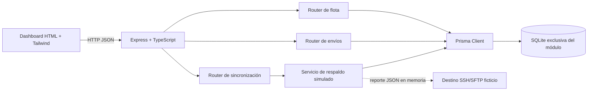

# Arquitectura técnica — MVP Logística Last-Mile & Smart Fleet v0.1.1

## Changelog v0.1.1

- Se crea un subsistema independiente con Node.js, TypeScript, Express, Prisma ORM 7 y SQLite mediante el adaptador `better-sqlite3`.
- Se incorporan los modelos de vehículos, conductores, envíos y logs de sincronización.
- Se añaden asignación de recursos, tracking de paquetes, dashboard operativo y respaldo SSH/SFTP simulado.
- El módulo mantiene su propia base y dependencias, sin acoplarse a los backends del resto del portfolio.

## Componentes y ERD

```mermaid
erDiagram
    VEHICULO ||--o{ ENVIO : asignado_a
    CONDUCTOR ||--o{ ENVIO : reparte
    VEHICULO {
        String id PK
        String patente UK
        String modelo
        EstadoVehiculo estado
        Int kilometraje
    }
    CONDUCTOR {
        String id PK
        String dni UK
        String nombre
        String apellido
        String licencia
        String telefono
    }
    ENVIO {
        String id PK
        String tracking_code UK
        String direccion_destino
        EstadoEnvio estado_envio
        String vehiculoId FK "nullable"
        String conductorId FK "nullable"
        DateTime fecha_creacion
    }
    LOGSSH_SYNC {
        String id PK
        DateTime fecha_sincronizacion
        String servidor_destino
        EstadoTransferencia estado_transferencia
        Int bytes_enviados
    }
```



Una unidad o conductor puede estar asociado con varios envíos históricos. Las claves foráneas de `Envio` son opcionales para permitir paquetes pendientes sin recursos asignados. Las asignaciones activas se expresan mediante `estado_envio = EN_CAMINO`.

## Componentes y aislamiento



El endpoint SSH de la demo no usa socket, cliente SSH ni SFTP real. El reporte se serializa en memoria, se calcula su tamaño UTF-8 y se registra un evento `EXITOSO` en SQLite. El destino predeterminado es `ubuntu@192.168.50.10:22`, configurable con `SSH_BACKUP_TARGET`.

Prisma obtiene `DATABASE_URL` desde `backend/.env` mediante `prisma.config.ts`; el cliente de la API se conecta con el adaptador local SQLite.

## Contrato de API

Base local predeterminada: `http://127.0.0.1:4100`. Los cuerpos y respuestas usan JSON.

| Método | Ruta | Respuesta / uso |
|---|---|---|
| `GET` | `/health` | Estado y versión del módulo. |
| `GET` | `/api/flota` | Vehículos y cantidad de envíos asociados. |
| `POST` | `/api/flota` | Alta de vehículo: `patente`, `modelo`, `kilometraje` opcional (entero no negativo). |
| `PATCH` | `/api/flota/:id/estado` | Cambia `estado` a `DISPONIBLE`, `EN_RUTA` o `TALLER`; rechaza sacar de ruta una unidad con envíos activos. |
| `GET` | `/api/flota/conductores` | Lista conductores. |
| `POST` | `/api/flota/conductores` | Alta de conductor: `dni`, `nombre`, `apellido`, `licencia`, `telefono`. |
| `GET` | `/api/envios` | Lista envíos recientes con vehículo y conductor, si existen. |
| `POST` | `/api/envios` | Registra `direccion_destino`; acepta `vehiculoId` y `conductorId` opcionales para asignación explícita. |
| `POST` | `/api/envios/:id/asignar` | Asigna al paquete pendiente el primer vehículo y conductor disponibles. |
| `PATCH` | `/api/envios/:id/estado` | Actualiza `estado_envio` a `PENDIENTE`, `EN_CAMINO` o `ENTREGADO`. Requiere asignación para iniciar el reparto. |
| `POST` | `/api/sync/ssh-backup` | Genera el reporte diario, simula la transferencia y guarda `LogSshSync`. |

### Alta y asignación de envíos

Ejemplo de alta:

```json
{ "direccion_destino": "Av. San Martín 123, Córdoba" }
```

Cuando existen tanto una unidad disponible como un conductor sin otro envío en camino, la operación los asigna y crea el envío en `EN_CAMINO`; de lo contrario, lo registra como `PENDIENTE`. La respuesta incluye el `tracking_code` generado con prefijo `LF-`. La asignación posterior usa `POST /api/envios/:id/asignar`. Los cambios que no pueden aplicarse devuelven `409`; identificadores inexistentes devuelven `404` y datos inválidos `400`.

### Respaldo simulado

`POST /api/sync/ssh-backup` responde con `log` persistido y `operation`, que contiene protocolo, destino, nombre del reporte, bytes enviados y estadísticas del día. Un resultado exitoso representa únicamente la simulación local. Si falla la consulta o escritura de la base, la API devuelve un error `500`; no presenta como éxito una transferencia que no se registró.

## Estados de dominio

- Vehículo: `DISPONIBLE`, `EN_RUTA`, `TALLER`.
- Envío: `PENDIENTE`, `EN_CAMINO`, `ENTREGADO`.
- Transferencia registrada: `EXITOSO`, `FALLIDO`.
- Al completar una entrega se libera el vehículo cuando no conserva otros envíos `EN_CAMINO`.

## Árbol del módulo

```text
mvp-logistica-fleet/
├── VERSION
├── README.md
├── docs/ARCHITECTURE.md
├── backend/
│   ├── .env.example
│   ├── package.json
│   ├── prisma.config.ts
│   ├── tsconfig.json
│   ├── prisma/schema.prisma
│   └── src/
│       ├── index.ts
│       ├── config/db.ts
│       ├── routes/flota.routes.ts
│       ├── routes/envios.routes.ts
│       ├── routes/ssh-sync.routes.ts
│       └── services/sshSync.service.ts
└── frontend/public/
    ├── index.html
    └── app.js
```
