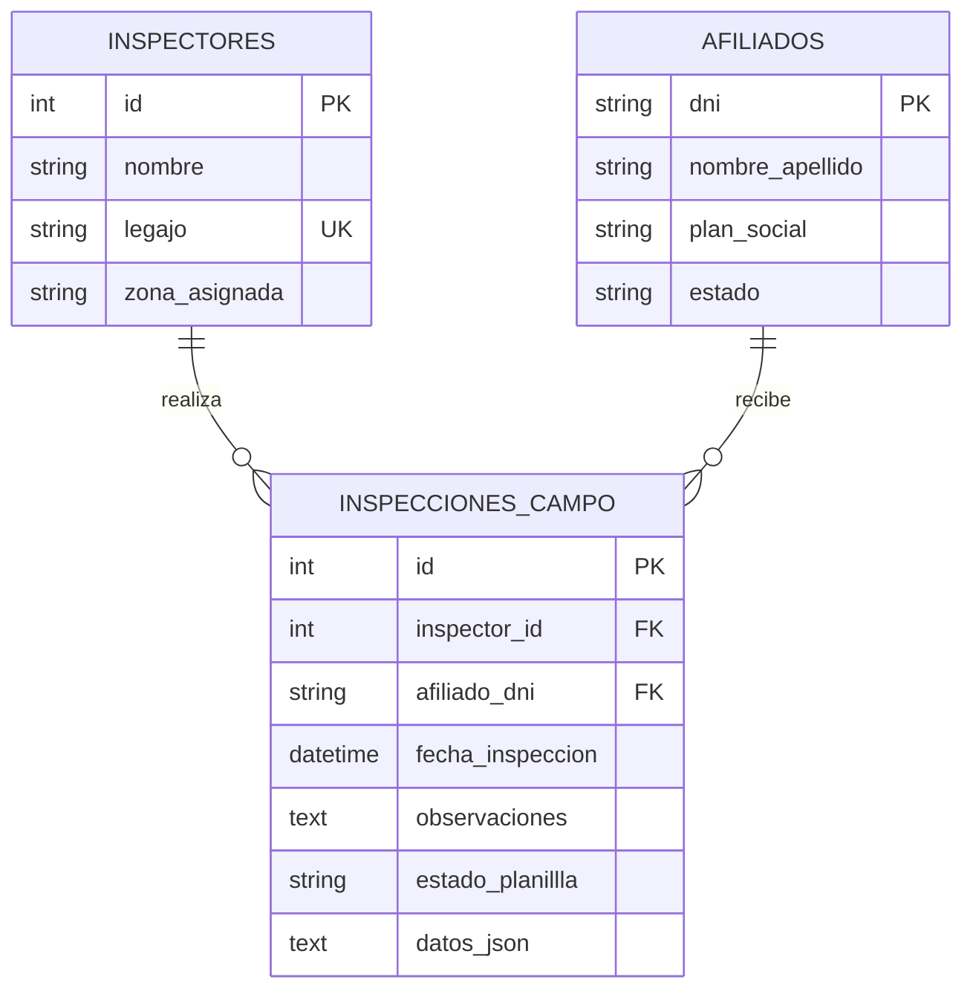

# Arquitectura técnica — MVP OSMA Inspecciones v0.1.1

## Changelog v0.1.1

- Se crea el subsistema independiente React PWA + FastAPI con SQLite local exclusiva.
- Se modelan inspectores, afiliados e inspecciones de campo con claves foráneas y restricciones de dominio.
- Se digitalizan los campos del formulario físico de referencia y se conserva la información complementaria en `datos_json`.
- Se implementan búsqueda y validación de cobertura de afiliados.
- Se agrega una cola offline local y sincronización idempotente por identificador de cliente.
- Se incluyen datos ficticios de demostración; no se migran datos personales del sistema OSMA existente.

## Vista de componentes

```text
React PWA (localhost:5173)
    ├── captura mobile-first de planillas
    ├── búsqueda y validación de afiliados
    ├── localStorage: cola de inspecciones y cachés de apoyo
    └── service worker: shell web para modo offline
          └── cliente HTTP
                └── FastAPI (localhost:8003)
                      ├── routers: inspectores, afiliados, sincronización
                      ├── services: sync_service
                      └── SQLAlchemy → backend/data/db/osma_mvp.db
```

## Entidad-relación de `osma_mvp.db`



`estado` acepta `ACTIVO` o `SUSPENDIDO`; el backend rechaza crear o sincronizar inspecciones para afiliados suspendidos. El campo se llama `estado_planillla` en SQLite según el nombre solicitado y admite `COMPLETA` o `PENDIENTE_SYNC`. Las filas sincronizadas se guardan como `COMPLETA`; las planillas aún offline viven en la cola del dispositivo, no en el servidor. `datos_json` conserva los campos del acta: `numero_acta`, `fecha_inspeccion`, `direccion`, `nombre_contacto`, `cuit`, `tipo`, `observacion1` y `observacion2`. La sincronización agrega allí `client_id` para hacer idempotentes los reintentos.

## Contrato REST

Base local: `http://127.0.0.1:8003`. Los recursos están prefijados con `/api`.

| Método | Ruta | Uso |
|---|---|---|
| `GET` | `/health` | Estado y versión del módulo. |
| `GET` | `/api/inspectores` | Lista inspectores disponibles. |
| `POST` | `/api/inspectores` | Registra `nombre`, `legajo` y `zona_asignada`; el legajo duplicado responde `409`. |
| `GET` | `/api/afiliados?q={texto}&limit={n}` | Busca por DNI exacto o nombre parcial; omitir `q` lista afiliados. |
| `GET` | `/api/inspecciones?inspector_id={id}` | Lista las inspecciones, opcionalmente filtradas por inspector. |
| `POST` | `/api/inspecciones` | Registra una inspección conectada y la marca `COMPLETA`. |
| `GET` | `/api/sync/estado` | Indica si el servicio de sincronización está disponible. La cola pendiente se conserva en cada dispositivo. |
| `POST` | `/api/sync/inspecciones` | Recibe un array de planillas con `client_id`, datos del inspector/afiliado, fecha, observaciones y `datos_json`; máximo 100 por lote. |

Ejemplo de carga de sincronización:

```json
[
  {
    "client_id": "uuid-generado-en-el-dispositivo",
    "inspector_id": 1,
    "afiliado_dni": "30000001",
    "fecha_inspeccion": "2026-10-31T12:00:00Z",
    "observaciones": "Observación 1: documentación verificada",
    "datos_json": {
      "numero_acta": "000123",
      "direccion": "Calle de prueba 100",
      "nombre_contacto": "Contacto de demostración",
      "cuit": "",
      "tipo": "nueva",
      "observacion1": "Documentación verificada",
      "observacion2": ""
    }
  }
]
```

La respuesta indica `CREADA` o `YA_SINCRONIZADA` para cada identificador. Un mismo `client_id` con contenido diferente responde `409`; inspector o afiliado inexistente responden `404`, y cobertura suspendida `409`. FastAPI expone OpenAPI en `/docs`.

## Aislamiento y operación offline

- El motor usa por defecto `backend/data/db/osma_mvp.db`; `OSMA_MVP_DATABASE_PATH` solo reubica la base de este MVP.
- SQLite activa claves foráneas y espera hasta 10 segundos ante bloqueos de escritura.
- La API limita CORS por defecto a `localhost:5173` y `127.0.0.1:5173`; `OSMA_MVP_CORS_ORIGINS` permite definir orígenes de despliegue explícitamente.
- La PWA conserva en el navegador la cola de planillas y cachés de afiliados/inspectores. Al reconectar, reenvía pendientes mediante `client_id`; el servidor evita duplicados si la respuesta de una carga anterior se perdió.
- El service worker almacena el shell y los recursos estáticos. Las llamadas REST no se almacenan ni se simulan: para consultar afiliados en modo offline solo están disponibles los registros previamente cacheados.
- El despliegue de demostración carece de autenticación; en una VM se recomienda TLS, proxy inverso y control de red antes de exponer la API.

## Árbol del módulo

```text
mvp-osma-inspecciones/ (directorio hermano de mvp-personal, mvp-auditoria y mvp-formularios)
├── VERSION
├── README.md
├── docs/ARCHITECTURE.md
├── backend/
│   ├── app/core/                 # Configuración, CORS y motor SQLAlchemy
│   ├── app/routers/              # Inspecciones, afiliados y sincronización
│   ├── app/services/sync_service.py
│   ├── data/db/osma_mvp.db
│   └── tests/
└── frontend/
    ├── public/                   # Manifest, icono y service worker
    └── src/                      # Interfaz React, cliente API y cola offline
```
