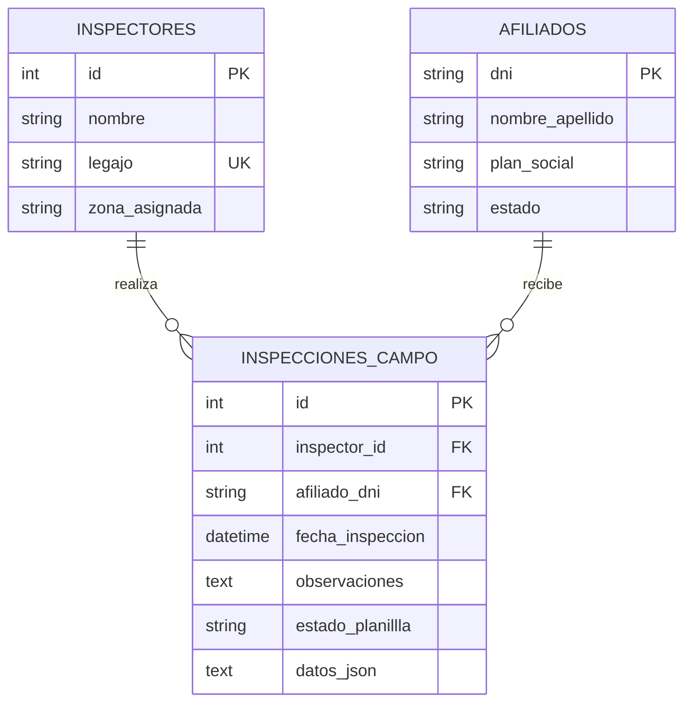

# Arquitectura técnica — MVP OSMA Inspecciones v0.2.0

## Changelog v0.2.0

- Se cifra la cola de inspecciones y las cachés privadas con AES-GCM-256 en IndexedDB.
- Se migra el almacenamiento plaintext previo y se elimina únicamente al completar la migración cifrada.
- Se agregan reintentos progresivos, estado de sincronización, recuperación al volver online y service worker para shell y recursos estáticos.

## Changelog v0.1.1

- Se crea el subsistema independiente React PWA + FastAPI con SQLite local exclusiva.
- Se modelan inspectores, afiliados e inspecciones de campo con claves foráneas y restricciones de dominio.
- Se digitalizan los campos del formulario físico de referencia y se conserva la información complementaria en `datos_json`.
- Se implementan búsqueda y validación de cobertura de afiliados.
- Se agrega una cola offline local y sincronización idempotente por identificador de cliente.
- Se incluyen datos ficticios de demostración; no se migran datos personales del sistema OSMA existente.

## Endurecimiento PWA offline

- Los formularios pendientes y las cachés privadas se guardan cifrados en IndexedDB mediante AES-GCM-256 (Web Crypto API); la clave no extraíble se guarda como `CryptoKey` en IndexedDB.
- La cola anterior en `localStorage` se migra al primer inicio y solo se elimina una vez completada su migración cifrada.
- Los reintentos usan `client_id`, lotes de hasta 100 y espera exponencial de hasta 15 minutos. Las respuestas confirmadas se conservan localmente como enviadas; los fallos quedan cifrados y pueden reintentarse manualmente.
- El panel de sincronización muestra pendientes, enviadas y errores. El navegador intenta sincronizar al volver online, recuperar el foco o activar Background Sync.
- Tailwind CSS se usa en los indicadores de estado; el service worker mantiene la app shell y los recursos estáticos, pero excluye las rutas API.

## Vista de componentes

```text
React PWA (localhost:5175)
    ├── captura mobile-first de planillas
    ├── búsqueda y validación de afiliados
    ├── IndexedDB: cola y cachés cifradas con Web Crypto API
    ├── panel Tailwind CSS: pendientes, enviadas y errores
    └── service worker: app shell, recursos estáticos y aviso de Background Sync
          └── cliente HTTP
                └── FastAPI (localhost:8005)
                      ├── routers: inspectores, afiliados, sincronización
                      ├── services: sync_service
                      └── SQLAlchemy → backend/data/db/osma_mvp.db
```

## Entidad-relación de `osma_mvp.db`



`estado` acepta `ACTIVO` o `SUSPENDIDO`; el backend rechaza crear o sincronizar inspecciones para afiliados suspendidos. El campo se llama `estado_planillla` en SQLite según el nombre solicitado y admite `COMPLETA` o `PENDIENTE_SYNC`. Las filas sincronizadas se guardan como `COMPLETA`; las planillas aún offline viven en la cola del dispositivo, no en el servidor. `datos_json` conserva los campos del acta: `numero_acta`, `fecha_inspeccion`, `direccion`, `nombre_contacto`, `cuit`, `tipo`, `observacion1` y `observacion2`. La sincronización agrega allí `client_id` para hacer idempotentes los reintentos.

## Contrato REST

Base local: `http://127.0.0.1:8005`. Los recursos están prefijados con `/api`.

| Método | Ruta | Uso |
|---|---|---|
| `GET` | `/health` | Estado y versión del módulo. |
| `GET` | `/api/inspectores` | Lista inspectores disponibles. |
| `POST` | `/api/inspectores` | Registra `nombre`, `legajo` y `zona_asignada`; el legajo duplicado responde `409`. |
| `GET` | `/api/afiliados?q={texto}&limit={n}` | Busca por DNI exacto o nombre parcial; omitir `q` lista afiliados. |
| `GET` | `/api/inspecciones?inspector_id={id}` | Lista las inspecciones, opcionalmente filtradas por inspector. |
| `POST` | `/api/inspecciones` | Registra una inspección conectada y la marca `COMPLETA`. |
| `GET` | `/api/sync/estado` | Indica si el servicio de sincronización está disponible. La cola pendiente se conserva en cada dispositivo. |
| `POST` | `/api/sync/inspecciones` | Recibe un array de planillas con `client_id`, datos del inspector/afiliado, fecha, observaciones y `datos_json`; máximo 100 por lote. |

Ejemplo de carga de sincronización:

```json
[
  {
    "client_id": "uuid-generado-en-el-dispositivo",
    "inspector_id": 1,
    "afiliado_dni": "30000001",
    "fecha_inspeccion": "2026-10-31T12:00:00Z",
    "observaciones": "Observación 1: documentación verificada",
    "datos_json": {
      "numero_acta": "000123",
      "direccion": "Calle de prueba 100",
      "nombre_contacto": "Contacto de demostración",
      "cuit": "",
      "tipo": "nueva",
      "observacion1": "Documentación verificada",
      "observacion2": ""
    }
  }
]
```

La respuesta indica `CREADA` o `YA_SINCRONIZADA` para cada identificador. Un mismo `client_id` con contenido diferente responde `409`; inspector o afiliado inexistente responden `404`, y cobertura suspendida `409`. FastAPI expone OpenAPI en `/docs`.

## Flujo de datos desconectado

1. Al guardar, el cliente genera un UUID `client_id`, construye el payload de inspección y lo cifra con AES-GCM-256 y un IV aleatorio. IndexedDB conserva el ciphertext, el IV y metadatos de estado; afiliados e inspectores cacheados también se cifran.
2. Al recuperar conexión, al volver a enfocar la aplicación o recibir un aviso de Background Sync, el cliente descifra localmente los registros elegibles y envía lotes de hasta 100 a `POST /api/sync/inspecciones`.
3. La respuesta se valida por `client_id`; los registros confirmados pasan al estado local `sent` y se conservan para mostrar historial. Si falla el lote, su contenido permanece cifrado, su estado pasa a `error` y se reintenta con backoff exponencial (máximo 15 minutos). El botón manual permite forzar un reintento.
4. El backend usa `client_id` para reconocer reenvíos y devolver `YA_SINCRONIZADA`, evitando duplicados cuando una respuesta anterior se pierde. Un `client_id` reutilizado con otro payload se rechaza con `409`.

El service worker usa caché network-first para navegación y cache-first para recursos estáticos del mismo origen. No intercepta ni almacena rutas `/api/` ni peticiones de otros orígenes. Background Sync avisa a una pestaña abierta para que el cliente ejecute la cola; si el navegador no ofrece Background Sync o la aplicación está cerrada, la sincronización se ejecuta al volver a abrirla o recuperar foco/conexión.

Las cargas se descifran en el cliente inmediatamente antes de enviarse al contrato JSON existente de FastAPI. En despliegues reales, la API debe servirse exclusivamente mediante HTTPS: el cifrado en IndexedDB protege los datos en reposo, no sustituye TLS ni protege frente a XSS o código malicioso ejecutándose bajo el mismo origen. La clave no extraíble evita exportar el material criptográfico mediante Web Crypto, pero se mantiene en el mismo perfil de navegador y no equivale a una clave protegida por contraseña o hardware.

Para validar el motor de almacenamiento: `cd frontend && npm test`. El build del frontend se valida con `npm run build`.

## Aislamiento y operación offline

- El motor usa por defecto `backend/data/db/osma_mvp.db`; `OSMA_MVP_DATABASE_PATH` solo acepta rutas dentro del módulo o del directorio temporal de pruebas y rechaza bases de otros subsistemas.
- SQLite activa claves foráneas y espera hasta 10 segundos ante bloqueos de escritura.
- La API limita CORS por defecto a `localhost:5175` y `127.0.0.1:5175`; `OSMA_MVP_CORS_ORIGINS` permite definir orígenes explícitos para el entorno local alternativo.
- IndexedDB conserva la cola y las cachés cifradas de afiliados/inspectores. Para consultar afiliados offline solo están disponibles los registros previamente cacheados.
- El despliegue de demostración carece de autenticación; en una VM se recomienda TLS, proxy inverso y control de red antes de exponer la API.

## Árbol del módulo

```text
mvp-osma-inspecciones/ (directorio hermano de mvp-personal, mvp-auditoria y mvp-formularios)
├── VERSION
├── README.md
├── docs/ARCHITECTURE.md
├── backend/
│   ├── app/core/                 # Configuración, CORS y motor SQLAlchemy
│   ├── app/routers/              # Inspecciones, afiliados y sincronización
│   ├── app/services/sync_service.py
│   ├── data/db/osma_mvp.db
│   └── tests/
└── frontend/
    ├── public/                   # Manifest, icono y service worker
    ├── src/                      # Interfaz React, cliente API y motor IndexedDB cifrado
    └── test/                     # Pruebas unitarias del almacenamiento offline
```
