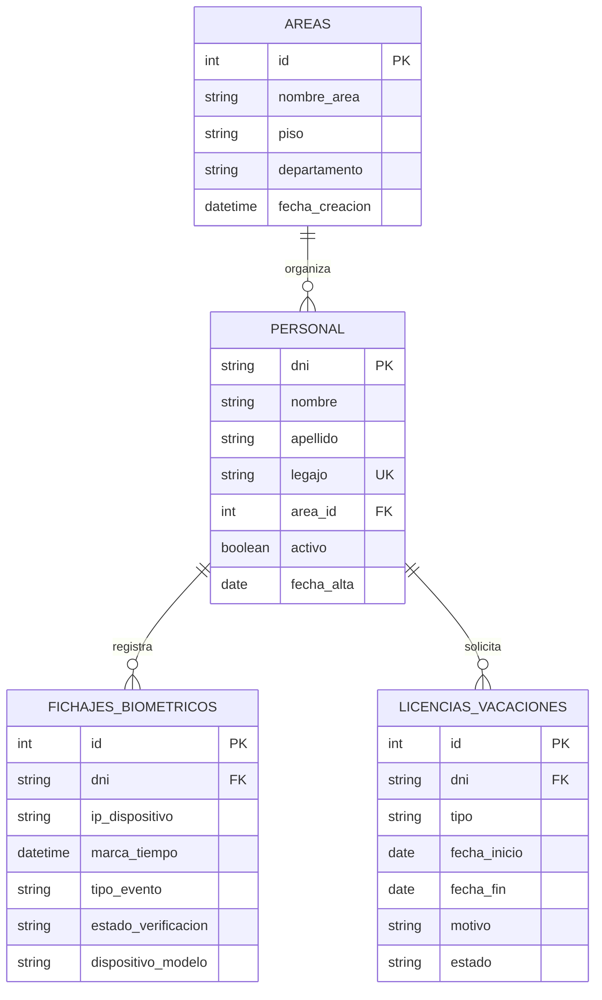

# Arquitectura técnica — MVP Personal v0.2.0

## Changelog v0.2.0

- Se agrega dashboard operativo y navegación lazy por funcionalidades en el frontend independiente.
- Se restringe la ruta configurable de SQLite al módulo o al directorio temporal de pruebas para mantener el aislamiento de datos.

## Changelog v0.1.1

- Se encapsula el control de personal en una aplicación FastAPI autónoma con SQLAlchemy y una base SQLite exclusiva.
- Se definen áreas, personal, fichajes biométricos y licencias con claves foráneas, restricciones de dominio e índices de consulta.
- Se incorporan ABM de personal/áreas/licencias, consulta de historial por DNI, simulación configurable de relojes y reportes diarios/semanales.
- El cálculo de reportes utiliza exclusivamente días laborables de lunes a viernes; las licencias aprobadas justifican la inasistencia en sus fechas cubiertas.
- Se agrega una interfaz Angular standalone + Tailwind para simular fichajes, operar personal y licencias, consultar historiales y visualizar reportes.
- Se incorpora navegación lazy por capacidades y un dashboard de control diario en el frontend local `4203`, separado de la landing `4200` y sin conflicto con el frontend de Formularios (`4202`).
- Se desacopla funcionalmente de `Sistema DOSEP Prestadores`: no se importa su aplicación, su esquema, sus credenciales, su SQLite ni sus integraciones PJE/auditoría.

## Vista de componentes

```text
Angular standalone + Tailwind (localhost:4203)
    └── clientes HTTP (Personal / Biométrico / Licencias / Reportes)
          └── FastAPI (localhost:8001)
                ├── routers: personal, asistencia, licencias, biometric_sim, reportes
                ├── services: sim_service, report_service
                └── SQLAlchemy → backend/data/db/personal_mvp.db
```

## Entidad-relación de `personal_mvp.db`



`tipo_evento` admite `ENTRADA` o `SALIDA`; `estado_verificacion`, `VERIFIED` o `FAILED`; `tipo` de licencia, `MEDICA`, `VACACION` u `OTRO`. El estado de licencia admite `PENDING`, `APPROVED` y `REJECTED`. Solo las licencias `APPROVED` justifican una ausencia. Las bajas de personal se representan por `activo = false`, preservando el historial y las referencias.

## API REST

Base local: `http://127.0.0.1:8001`. Todos los recursos de dominio están prefijados con `/api`.

| Método | Ruta | Uso |
|---|---|---|
| `GET` | `/health` | Estado y versión del módulo. |
| `GET` | `/api/personal` | Lista personal; admite `dni` y `activo` como filtros. |
| `POST` | `/api/personal` | Alta con DNI, nombre, apellido, legajo y área opcional. |
| `PATCH` | `/api/personal/{dni}` | Actualiza datos permitidos, incluyendo activación/desactivación. |
| `GET` | `/api/personal/areas` | Lista áreas, pisos y departamentos. |
| `POST` | `/api/personal/areas` | Crea un área. |
| `PATCH` | `/api/personal/areas/{area_id}` | Actualiza nombre, piso o departamento. |
| `GET` | `/api/asistencia/{dni}` | Historial de fichajes (parámetro `limite`, máximo 500). |
| `POST` | `/api/biometric/simular` | Registra una marca mockeada. Acepta DNI opcional (asigna una persona activa), IP local opcional, fecha/hora opcional para reproducir una trama, evento, verificación y modelo (`ZKBio`, `Suprema`, `Hikvision`). |
| `GET` | `/api/reportes/diario?fecha=YYYY-MM-DD` | Reporte diario; en fin de semana responde `dia_habil: false` y no calcula registros. |
| `GET` | `/api/reportes/semanal?fecha=YYYY-MM-DD` | Reporte de lunes a viernes de la semana de referencia. |
| `GET` | `/api/licencias?dni=...` | Lista licencias, opcionalmente filtradas por DNI. |
| `POST` | `/api/licencias` | Registra licencia con tipo, rango inclusivo, motivo y estado. |

El simulador valida que la IP sea privada, loopback o link-local, pero nunca abre conexiones de red. Si la trama omite evento/resultado, el servicio genera valores mockeados. Si la simulación omite DNI, usa la primera persona activa ordenada por DNI; sin personal activo retorna `404`.

## Reglas de reportes

- Las semanas se anclan al lunes de la fecha de consulta y se componen de cinco fechas laborables.
- El reporte diario de sábado/domingo devuelve una lista vacía y no agrega ausencias ni justificaciones.
- Solo se consideran personas activas. Una marca `ENTRADA` verificada implica `PRESENTE`; una licencia aprobada que cubre la fecha implica `JUSTIFICADA`; en otro caso se informa `AUSENTE`.
- Las marcas `FAILED` se conservan para auditoría del simulador, pero no se contabilizan como asistencia.
- Las fechas de licencia son inclusivas. No se requiere una marca de entrada para reconocer una licencia aprobada.

## Aislamiento

- FastAPI inicializa un motor SQLAlchemy SQLite apuntando por defecto a `backend/data/db/personal_mvp.db`; `PERSONAL_MVP_DATABASE_PATH` solo acepta rutas dentro del módulo o del directorio temporal de pruebas y rechaza rutas de otros subsistemas.
- El motor activa claves foráneas SQLite en cada conexión. Las tablas se crean desde los modelos locales de SQLAlchemy.
- Este subsistema no comparte sesiones, modelos, tablas, archivos de base ni variables de conexión con `Sistema DOSEP Prestadores`.
- No tiene dependencias de SQL Server PJE, pyodbc, auditoría, prestadores ni otros servicios externos. La única comunicación del frontend es HTTP con esta API local.
- Las marcas son generadas sintéticamente; no hay sockets, SDK de fabricantes ni tráfico hacia IPs biométricas.

## Árbol del módulo

```text
mvp-personal/
├── VERSION
├── README.md
├── docs/ARCHITECTURE.md
├── backend/
│   ├── app/core/                 # Configuración y motor SQLAlchemy
│   ├── app/routers/              # API aislada por dominio
│   ├── app/services/             # Simulación y reglas de reportes
│   ├── data/db/personal_mvp.db   # SQLite creada al iniciar
│   └── tests/
└── frontend/
    └── src/app/
        ├── app.routes.ts           # Rutas lazy por capacidad
        ├── core/services/        # Clientes HTTP por módulo
        └── features/             # Dashboard, simulador, personal, asistencia, reportes y licencias
```

### Rutas de la interfaz

| Ruta | Capacidad |
|---|---|
| `/dashboard` | Estado diario, tarjetas de control, tabla compacta y acceso lateral a licencias. |
| `/fichajes` | Simulación de marcas biométricas. |
| `/personal` | Administración de personal y áreas. |
| `/asistencia` | Historial de marcas por DNI. |
| `/licencias` | Registro y consulta de licencias/vacaciones. |
| `/reportes` | Reportes diarios y semanales de días hábiles. |
