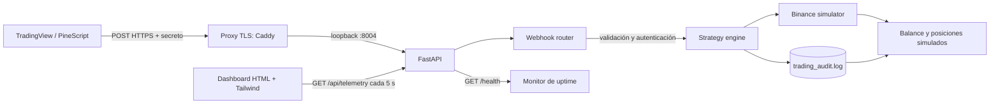

# Arquitectura técnica — MVP Valentín Cripto v0.1.1

## Changelog v0.1.1

- Se crea un subsistema FastAPI aislado para recibir alertas TradingView y servir un dashboard HTML/Tailwind.
- Se valida el secreto del webhook con comparación en tiempo constante y se rechazan señales con campos o valores inválidos.
- Se implementa un ledger Binance simulado, sin credenciales ni llamadas externas, y un log JSON Lines local de auditoría.
- Se exponen salud y telemetría para seguimiento del servicio y se documenta el despliegue tras TLS en VM OCI/AWS.

## Componentes y flujo



El módulo no reutiliza base de datos, credenciales ni procesos de los otros MVP del portfolio. FastAPI sirve dashboard, endpoints y telemetría; la lógica de señales produce únicamente operaciones simuladas.

## Contrato de API

Base local: `http://127.0.0.1:8004`. En despliegues públicos se debe usar HTTPS en el proxy inverso.

| Método | Ruta | Uso |
|---|---|---|
| `GET` | `/health` | Estado y versión del módulo. No requiere secreto. |
| `GET` | `/` | Dashboard telemétrico. |
| `GET` | `/api/telemetry` | Estrategia más reciente, última señal, agregados, últimas 20 órdenes y balance/posiciones simulados. |
| `GET` | `/api/simulator/balance` | Balance y posiciones simulados. |
| `POST` | `/api/webhook/tradingview` | Autentica y procesa una señal de TradingView. |
| `GET` | `/docs` | OpenAPI interactivo de FastAPI. |

### `POST /api/webhook/tradingview`

Cabecera `Content-Type: application/json`. En el body se acepta el secreto como `key` o `token`; se compara con `WEBHOOK_SECRET`:

```json
{
  "key": "secreto-compartido",
  "event_id": "id-opcional",
  "strategy": "JOKER PRO",
  "symbol": "SOLUSDT.P",
  "action": "buy",
  "1": 0.03,
  "price": 150.25,
  "tp": 154.0,
  "sl": 148.0,
  "probability": 75
}
```

| Campo | Tipo | Requisito |
|---|---|---|
| `key` o `token` | string | Obligatorio en la práctica: debe coincidir con `WEBHOOK_SECRET`. |
| `strategy` | string | Opcional, por defecto `TradingView`. |
| `symbol` | string | Obligatorio, longitud máxima 40. |
| `action` | string | Obligatorio: `buy` o `sell`. |
| `quantity` o `"1"` | número | Obligatorio y mayor que cero; `"1"` admite el formato de scripts Pine existentes. |
| `price` | número | Obligatorio, finito y mayor que cero. |
| `tp`, `sl` | número | Opcionales, finitos y mayores que cero. Solo se registran; no activan órdenes de salida. |
| `probability` | número | Opcional, de 0 a 100. |
| `event_id` | string | Opcional; se devuelve para correlación, no deduplica solicitudes. |

Respuesta aceptada (`202 Accepted`):

```json
{
  "status": "accepted",
  "simulated": true,
  "event_id": "id-opcional",
  "order": {
    "order_id": "UUID",
    "symbol": "SOLUSDT.P",
    "side": "buy",
    "status": "FILLED",
    "simulated": true,
    "filled_quantity": 0.03,
    "average_price": 150.25,
    "realized_pnl": 0,
    "balance": 10000,
    "position_quantity": 0.03
  }
}
```

`401` indica credencial incorrecta; `422`, payload inválido; `503`, secreto no configurado; `500`, error de escritura del log. La API no devuelve el secreto en respuestas o registros. Las alertas que TradingView reintente pueden volver a procesarse, pues el MVP no implementa idempotencia.

## Simulador y telemetría

El simulador mantiene posiciones netas long/short por símbolo. Una operación que cierra o reduce una posición actualiza el balance por PnL realizado; aumentar o abrir una posición conserva el promedio ponderado de entrada. No simula margen, comisiones, funding, deslizamiento ni liquidez. El saldo inicial predeterminado es 10.000 unidades. No equivale al balance de una cuenta real ni al saldo de Binance.

El motor añade cada orden ejecutada al archivo `backend/data/logs/trading_audit.log` como una línea JSON. La telemetría agrega el historial del archivo y las últimas 20 operaciones; el estado del simulador está en memoria, por lo que el balance y las posiciones se reinician al reiniciar el proceso aunque el historial persista. Use un solo worker.

## Aislamiento y operación cloud

- Dependencias de runtime limitadas a FastAPI y Uvicorn; no se instala cliente Binance ni SDK de exchange.
- `WEBHOOK_SECRET` es obligatorio para aceptar webhooks; sin configuración el endpoint responde `503`.
- `TRADING_AUDIT_PATH` permite ubicar el log. El usuario del servicio necesita permiso de escritura en la carpeta.
- En OCI/AWS se permite `22` solo desde IP administrativa, y `80`/`443` para proxy TLS. Uvicorn escucha en `127.0.0.1:8004`; no se publica ese puerto.
- `backend/scripts/check_uptime.sh` comprueba `/health` y permite integrarse con cron/monitoreo externo.
- El dashboard y las rutas de telemetría son de solo lectura y no requieren login en este MVP; añada controles de acceso en el proxy antes de exponer métricas sensibles.

## Árbol del módulo

```text
mvp-valentin-cripto/
├── VERSION
├── README.md
├── docs/ARCHITECTURE.md
├── backend/
│   ├── app/main.py
│   ├── app/routers/
│   │   ├── binance_sim.py
│   │   └── webhooks.py
│   ├── app/services/strategy_engine.py
│   ├── data/logs/trading_audit.log  (creado al procesar la primera orden)
│   ├── scripts/check_uptime.sh
│   └── tests/test_webhooks.py
└── frontend/dashboard.html
```
