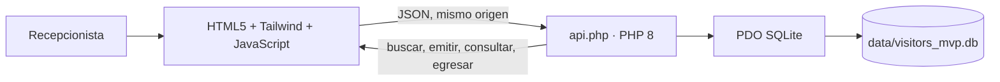
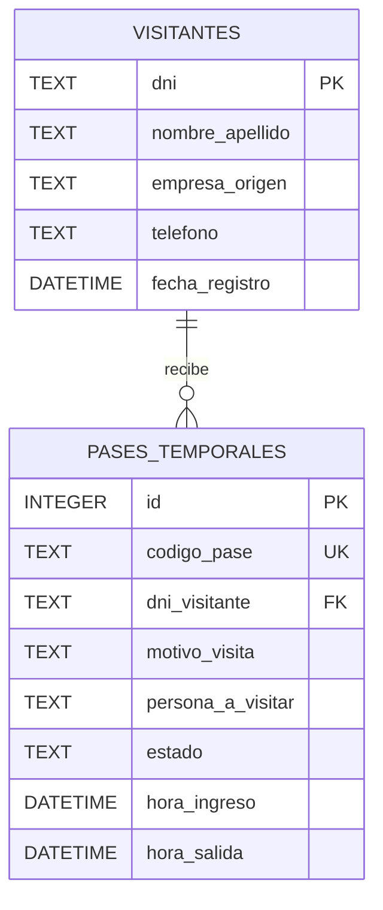

# Arquitectura técnica — MVP Visitor Pass v0.1.1

## Componentes y flujo

El módulo se ejecuta de forma independiente desde su directorio. PHP sirve tanto `index.html` como la API, PDO persiste los registros en SQLite y no existen dependencias de otros MVP ni llamadas de aplicación a servicios externos. Tailwind CSS se descarga desde CDN para la interfaz.

## Modelo relacional

La base se crea como `data/visitors_mvp.db` en el primer acceso a `api.php`. La clave foránea está habilitada por conexión; el estado se limita a `ACTIVO` o `FINALIZADO` mediante `CHECK`. Un pase activo representa una persona que todavía no registró salida. La finalización actualiza el estado y `hora_salida`, sin borrar el historial.

## Contrato API

Base local: `http://localhost:8000/api.php`. Las respuestas son JSON UTF-8. Las escrituras reciben objetos JSON con `Content-Type: application/json`.

| Método | Acción | Parámetros / body | Resultado |
|---|---|---|---|
| `GET` | `?action=visitor&dni={dni}` | DNI en query | Visitante encontrado; `404` si no existe. |
| `GET` | `?action=active` | — | Lista de pases activos y datos asociados del visitante. |
| `POST` | `?action=visitor` | `dni`, `nombre_apellido`, `empresa_origen`, `telefono` | Crea el visitante; `409` si el DNI ya existe. |
| `POST` | `?action=pass` | `dni`, `motivo_visita`, `persona_a_visitar` | Emite un código aleatorio `VP-...` y registra el ingreso. |
| `POST` | `?action=exit&id={id}` | ID de pase en query | Finaliza un pase activo y marca la hora de salida. |

Los textos se recortan y validan por longitud. Errores de entrada devuelven `400` o `422`; visitante inexistente devuelve `404`; acciones desconocidas `404`; métodos no permitidos `405`; errores de persistencia `500` con detalle técnico solo en el log del servidor. Una salida repetida o sobre un ID inexistente devuelve `404`.

## Interfaz operativa

- Búsqueda por DNI y registro guiado si aún no existe.
- Emisión del pase con anfitrión y motivo; la emisión registra el ingreso.
- Panel de pases activos con código, visitante y datos resumidos.
- Registro de salida y actualización de la lista.
- Los datos dinámicos se insertan usando nodos de texto del DOM, no como HTML interpretado.

## Aislamiento y límites

- SQLite exclusiva en `data/visitors_mvp.db`, ubicada dentro de este módulo.
- La API no configura CORS: está prevista para ser consumida desde el mismo origen servido por PHP.
- No implementa autenticación ni autorización; restringe el servidor a loopback y no lo expongas en redes públicas.
- Tailwind CDN requiere conexión a Internet. El resto del flujo de aplicación es local.
- Los timestamps de SQLite usan `CURRENT_TIMESTAMP` (UTC); se presentan tal como los devuelve SQLite.
- Es un MVP de demostración, no sustituye un sistema de seguridad física ni controles de privacidad corporativos.
