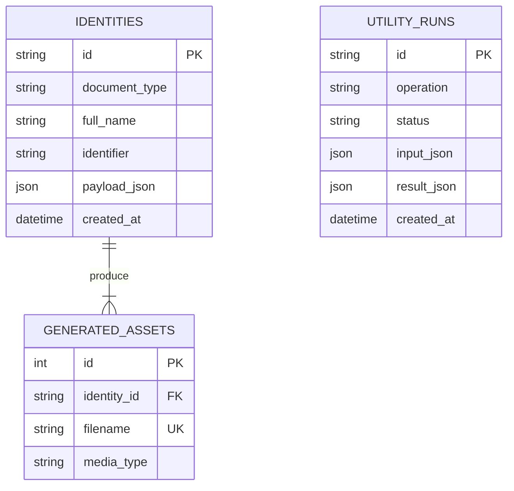

# Arquitectura — Service Synthetic Factory `0.1.0`

**Versión:** `0.1.0`

## Propósito y límites

Herramienta standalone para fixtures y verificaciones locales. No importa módulos ajenos, no comparte bases de datos, no consulta fuentes oficiales y no valida personas o credenciales. DNI/CUIT, matrículas, facturas, firmas y datos son sintéticos y se marcan como no válidos en las salidas visuales.

El API y Vite se ligan a loopback. No hay autenticación, ni despliegue público previsto, ni conexión MCP/Webhook saliente. `factory.ideal-it.site` requiere autenticación, protección CSRF/CORS, rate limits, controles de archivos, TLS y revisión de despliegue antes de cualquier exposición.

## Componentes

```text
React 19 + Vite (127.0.0.1:4209)
    └── proxy local /api
          └── FastAPI (127.0.0.1:8009)
                ├── routers: generators, validators, converters, mcp_bridge
                ├── services: generación de identidades, PDF y logs locales
                ├── backend/data/generated/ (JPEG/PDF temporales)
                └── SQLite propia: backend/data/db/factory_mvp.db
```

## Persistencia



Cada conexión SQLite activa `PRAGMA foreign_keys=ON`. El esquema usa claves foráneas con `ON DELETE CASCADE` para assets de identidad. `FACTORY_DATABASE_PATH` solo permite rutas dentro del módulo o del directorio temporal de pruebas. Las rutas de generación guardan metadatos de perfil/assets; el archivo se guarda en `backend/data/generated/`. Los assets generados y la DB se excluyen de Git.

`utility_runs` conserva actividad de validadores, conversores, mock data y simuladores. Por privacidad no persiste payloads del usuario, archivos cargados, texto convertido ni datos del webhook; solo guarda metadatos y resultados resumidos.

## Módulos y contratos

Todos los endpoints funcionales están bajo `/api/v1`:

| Router | Rutas | Responsabilidad |
|---|---|---|
| `generators` | `/generators/profiles`, `/generators/medical-credentials`, `/generators/invoices` | Fixtures con identificadores de namespace ficticio, JPEG/PDF y marcas de no validez. |
| `validators` | `/validators/structure`, `/validators/file-integrity`, `/validators/email`, `/validators/identity` | JSON/esquemas dinámicos, formato/MX de correo, DNI/CUIT de Argentina, RUT de Chile, CI de Uruguay, MIME y SHA-256; archivos hasta 10 MB. |
| `converters` | `/converters/convert`, `/converters/mock-data`, `/converters/files/*` | JSON/YAML, CSV/JSON, Markdown/HTML escapado, CSV/JSON descargable, Markdown/PDF (ReportLab), compresión JPEG/PNG/WebP y salida mock de hasta 500 filas. |
| `mcp_bridge` | `/mcp-bridge/status`, `/resources`, `/tools`, `/webhooks/simulate` | Simulación in-process; sin servidor público, agente externo ni request saliente. |

Se mantienen las rutas legacy `/api/v1/generate/dni` y `/api/v1/generate/medical-license`, además de historial y entrega restringida de assets.

Los `schema_adapters` dentro de perfiles son ejemplos JSON para pruebas manuales de Personal, Auditoría, Visitor Pass, Portal Ciudadano y POS. No son integraciones runtime ni contratos de compatibilidad permanente; no conectes las SQLite de otros subsistemas.

## Archivos y seguridad de entrada

- Los bytes subidos se leen en memoria hasta 10 MB, no se escriben ni se ejecutan. La allowlist MIME no sustituye un análisis antimalware.
- Las conversiones de imagen limitan la entrada a 40 megapíxeles y producen JPEG; las zonas transparentes se aplanan sobre blanco.
- La consulta MX, si se solicita, consulta DNS para el dominio (no para la dirección completa); fallos del resolvedor se informan como HTTP 503.
- El MIME se identifica por firma/estructura cuando es posible y se contrasta con el MIME declarado.
- Markdown se convierte con escape HTML/PDF; identificadores de tablas SQL son constantes internas y valores entrecomillados.
- Los PDF de identidad, credencial médica y factura llevan avisos visibles de demostración y no validez.
- La firma HMAC del webhook usa una clave aleatoria de proceso y solo ilustra una firma; no autentica integraciones reales.
- CORS acepta solo los orígenes `localhost:4209` y `127.0.0.1:4209`.

## Ejecución y pruebas

Desde `backend/`: `python -m pytest`. Los tests crean DB y directorio de assets temporales y verifican generación, APIs, CORS, claves foráneas y aislamiento. Desde `frontend/`: `npm run build`.
