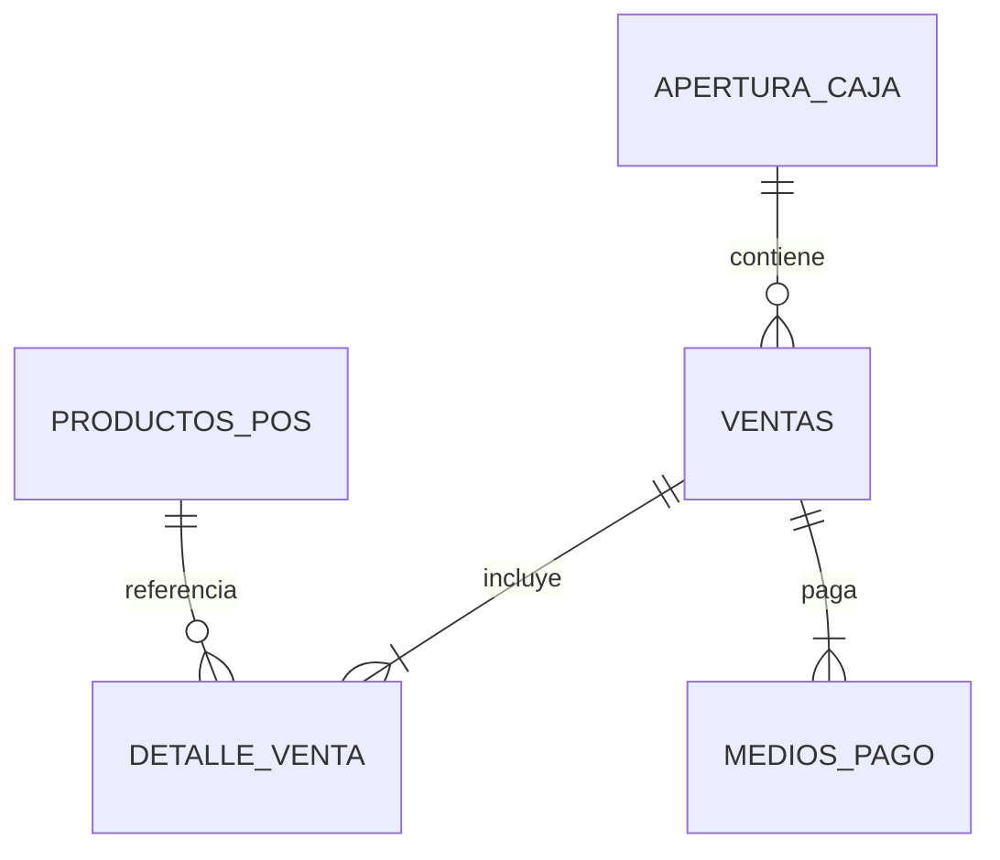

# Arquitectura — Web POS Comercial 0.1.0

## Componentes e aislamiento

```text
React + Vite + Tailwind CSS (127.0.0.1:4204)
  └── cliente HTTP local
       └── FastAPI (127.0.0.1:8007)
            ├── reglas de caja y ventas
            └── SQLModel → backend/data/db/pos_mvp.db
```

La API solo acepta los orígenes locales del frontend por CORS. La UI usa el puerto dedicado `4204` (strict port) y la API `8007`, sin colisionar con los puertos ya documentados. `POS_COMERCIAL_DATABASE_PATH` solo acepta rutas dentro del módulo o del directorio temporal de pruebas; no permite compartir archivos con otros módulos. La base y sus archivos auxiliares no se versionan. Cada conexión SQLite habilita claves foráneas. `create_all` crea el esquema inicial; futuros cambios de esquema con datos persistentes requieren una migración versionada.

## Persistencia

| Tabla | Responsabilidad |
|---|---|
| `AperturaCaja` | Turno, fondo inicial, estado y valores declarados al cierre. |
| `Ventas` | Importe total, fecha, vuelto y caja asociada. |
| `DetalleVenta` | Producto, cantidad, precio unitario y subtotal histórico. |
| `MediosPago` | Medio simulado, importe aplicado e importe recibido. |
| `ProductosPOS` | Catálogo ficticio con código, categoría y precio vigente. |



## Reglas de negocio

1. Solo puede existir una caja abierta; el cierre requiere un turno activo.
2. No se registra una venta sin caja, detalle no vacío, producto activo o cantidad positiva.
3. Las cantidades se consolidan por producto y el precio de la venta se toma del catálogo del servidor, no del navegador.
4. Los medios son `EFECTIVO`, `TARJETA_SIMULADA` y `QR_SIMULADO`. El importe no efectivo se aplica íntegramente; el efectivo ingresado cubre el saldo restante. El eventual excedente en efectivo es vuelto.
5. El pago aplicado debe ser exactamente igual al total de venta. Solo el efectivo puede generar vuelto.
6. El efectivo esperado al cierre es fondo inicial más efectivo aplicado a ventas; tarjeta y QR simulados no incrementan el cajón.
7. El cierre registra el efectivo contado y su diferencia frente al esperado. No se altera el historial de ventas.

## API local

Base: `http://127.0.0.1:8007`; OpenAPI en `/docs`.

| Método | Ruta | Uso |
|---|---|---|
| `GET` | `/health` | Estado y versión. |
| `GET` | `/api/productos` | Catálogo activo. |
| `GET` | `/api/caja/actual` | Turno abierto o `null`. |
| `POST` | `/api/caja/aperturas` | Abre turno con `monto_inicial`. |
| `GET` | `/api/caja/actual/reporte` | Totales y desglose del turno. |
| `POST` | `/api/caja/cierre` | Cierra con `monto_cierre_declarado` y devuelve conciliación. |
| `POST` | `/api/ventas` | Registra venta con `items` y múltiples `pagos`. |
| `GET` | `/api/ventas` | Historial reciente, opcionalmente filtrado por caja. |

Ejemplo de venta:

```json
{
  "items": [{"producto_id": 1, "cantidad": 2}],
  "pagos": [
    {"medio": "TARJETA_SIMULADA", "monto": "1200.00"},
    {"medio": "EFECTIVO", "monto": "1000.00"}
  ]
}
```

En un pago efectivo, `monto` es el efectivo recibido; el servidor calcula el saldo en efectivo aplicado y el vuelto. En los demás medios, `monto` es el importe aplicado. Las respuestas incluyen valores monetarios con precisión de dos decimales. Conflictos de caja y pagos inválidos responden `409`; recursos inexistentes, `404`; entradas inválidas, `422`.

## Interfaz táctil

La UI prioriza botones de producto grandes, búsqueda por nombre/código/categoría y agregado por Enter (compatible con lectores de códigos que emulan teclado), controles de cantidad y resumen del carrito en una columna persistente. El modal de cobro muestra saldo y vuelto antes de confirmar. Después de registrar la venta, presenta un comprobante HTML imprimible y permite guardarlo como PDF desde el navegador. El reporte de cierre diferencia efectivo esperado, contado y variación. Los errores de red y de validación se informan en pantalla.

## Datos y seguridad

Los productos de inicio son ficticios. No hay conectores bancarios, QR cobrables ni captura de datos de tarjeta. Esta demo no incorpora autenticación ni autorización y no debe exponerse a Internet ni procesar datos de pago reales.
