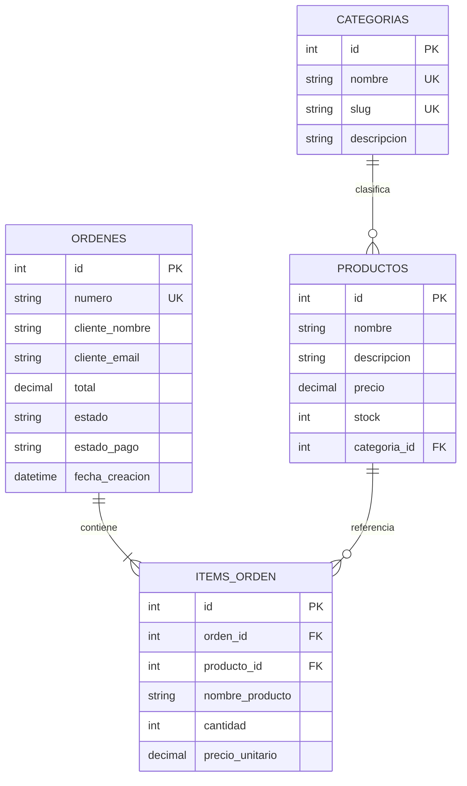

# Arquitectura técnica — Tienda Virtual 0.1.0

## Vista de componentes

```text
React + Vite + Tailwind (localhost:4206)
    └── cliente HTTP local / carrito reactivo
          └── FastAPI (127.0.0.1:8010)
                ├── productos y categorías: CRUD / catálogo
                ├── carrito: cantidades en memoria por X-Cart-ID
                ├── checkout: validación de stock y pago demo
                └── SQLAlchemy → backend/data/db/tienda_mvp.db
```

## Entidad-relación



SQLite activa `PRAGMA foreign_keys=ON` en cada conexión. Categorías y productos referenciados por órdenes no se pueden eliminar. Cada item de orden guarda nombre y precio como valores históricos; el producto referenciado se conserva para mantener la integridad referencial.

## API local

Base URL: `http://127.0.0.1:8010`. CORS permite únicamente los orígenes `localhost:4206` y `127.0.0.1:4206`. Las rutas de dominio devuelven errores HTTP explícitos: `404` para recursos inexistentes, `409` para conflictos de stock o integridad, `400` para carrito vacío y `422` para datos inválidos.

| Método | Ruta | Uso |
|---|---|---|
| `GET` | `/health` | Estado y versión del módulo. |
| `GET` | `/api/categorias` | Lista categorías. |
| `POST` | `/api/categorias` | Crea categoría con nombre, slug y descripción. |
| `PATCH` | `/api/categorias/{id}` | Actualiza campos de una categoría. |
| `DELETE` | `/api/categorias/{id}` | Elimina categoría si no tiene productos. |
| `GET` | `/api/productos?categoria_id=1&q=taza` | Catálogo, con filtros opcionales por categoría y nombre. |
| `GET` | `/api/productos/{id}` | Obtiene el detalle de un producto. |
| `POST` | `/api/productos` | Crea producto: `nombre`, `descripcion`, `precio`, `stock`, `categoria_id`. |
| `PATCH` | `/api/productos/{id}` | Actualiza los campos enviados del producto. |
| `DELETE` | `/api/productos/{id}` | Elimina producto si no tiene órdenes asociadas. |
| `GET` | `/api/carrito` | Consulta carrito de la sesión. |
| `POST` | `/api/carrito/items` | Suma `{ "producto_id": 1, "cantidad": 1 }` al carrito. |
| `PATCH` | `/api/carrito/items/{producto_id}` | Define la cantidad del item. |
| `DELETE` | `/api/carrito/items/{producto_id}` | Quita un item. |
| `DELETE` | `/api/carrito` | Vacía el carrito. |
| `POST` | `/api/checkout` | Registra una orden desde el carrito y simula el pago. |
| `GET` | `/api/ordenes/{id}` | Consulta la orden y sus items. |

Las rutas de carrito y checkout requieren `X-Cart-ID` (identificador anónimo de entre 8 y 64 caracteres). El checkout recibe `cliente_nombre` y `cliente_email`, vuelve a verificar stock y, en una sola transacción, descuenta inventario y persiste orden e items. Una orden confirmada devuelve `estado: "confirmada_demo"` y `estado_pago: "simulado_aprobado"`. El carrito se mantiene en memoria del proceso y se vacía tras una confirmación exitosa.

## Interfaz

- Catálogo: búsqueda, filtro de categoría y acceso al detalle.
- Detalle: descripción, precio, disponibilidad y acción para agregar al carrito.
- Carrito: cantidades, subtotal, total y formulario de checkout.
- Confirmación: número de orden, items y aviso visible de pago simulado.
- La interfaz solo realiza llamadas HTTP a la API local indicada; no carga librerías, imágenes ni servicios externos.

## Aislamiento y datos

- La base por defecto es `backend/data/db/tienda_mvp.db`; `TIENDA_DATABASE_PATH` solo acepta rutas dentro del módulo o del directorio temporal de pruebas.
- El esquema pertenece a este subsistema y no comparte SQLite, tablas, configuración ni sesiones con otros MVP.
- El catálogo inicial usa artículos sintéticos y se crea solo si la base no contiene categorías.
- No existe integración con procesadores de pago. No introducir datos de tarjeta ni usar datos personales o de inventario reales.

## Árbol del módulo

```text
web-tienda-virtual/
├── VERSION
├── README.md
├── docs/ARCHITECTURE.md
├── backend/
│   ├── main.py
│   ├── models.py
│   ├── schemas.py
│   ├── database.py
│   ├── data/db/tienda_mvp.db   # SQLite creada al iniciar
│   └── tests/
└── frontend/
    ├── package.json
    └── src/
        ├── api.js
        ├── App.jsx
        └── index.css
```
